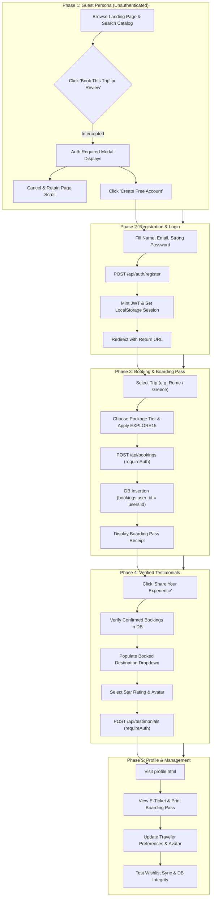
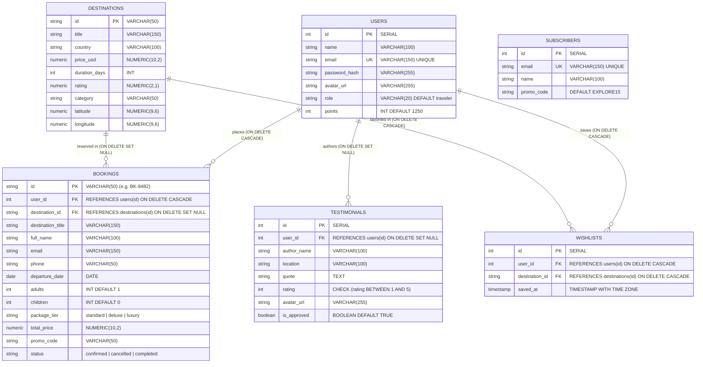

# 🌐 Jadoo Tours — End-to-End (E2E) Full System Testing Plan

> **Document Type:** Master End-to-End Test Plan & Quality Assurance Specification  
> **Target Environment:** Development & Staging (`dev` branch)  
> **Database:** PostgreSQL (Render Managed)  
> **Coverage:** Frontend UI (Every button & interaction), Client State, REST API & Relational Database Integrity  
> **Last Updated:** November 2026

---

## 📑 Table of Contents
1. [Executive Summary & Testing Architecture](#1-executive-summary--testing-architecture)
2. [Database Schema & Relational Integrity Blueprint](#2-database-schema--relational-integrity-blueprint)
3. [Phase 1: Guest (Unauthenticated) State Testing & Security Boundary Verification](#3-phase-1-guest-unauthenticated-state-testing--security-boundary-verification)
4. [Phase 2: Traveler Registration, Authentication & JWT Session Flow](#4-phase-2-traveler-registration-authentication--jwt-session-flow)
5. [Phase 3: Authenticated Destinations Catalog & Live Booking Flow](#5-phase-3-authenticated-destinations-catalog--live-booking-flow)
6. [Phase 4: Verified Testimonials & Customer Review Flow](#6-phase-4-verified-testimonials--customer-review-flow)
7. [Phase 5: User Profile, Digital Boarding Pass & Itinerary Flow](#7-phase-5-user-profile-digital-boarding-pass--itinerary-flow)
8. [Phase 6: Newsletter Concierge, VIP Vouchers & EmailJS Flow](#8-phase-6-newsletter-concierge-vip-vouchers--emailjs-flow)
9. [Phase 7: Relational Database Constraints & Orphan Prevention Verification](#9-phase-7-relational-database-constraints--orphan-prevention-verification)
10. [Phase 8: Comprehensive Button & Interactive Element Matrix](#10-phase-8-comprehensive-button--interactive-element-matrix)
11. [Execution Checklist & Automated Test Scripts](#11-execution-checklist--automated-test-scripts)

---

## 1. Executive Summary & Testing Architecture

This document defines the complete end-to-end verification plan for the Jadoo Tours travel web platform. It enforces a **Zero-Security-Leak** and **Zero-UI-Trap** standard.

### Testing Methodology:
1. **Unauthenticated First (Guest Persona):** Verify that every protected action (booking flights, posting reviews, viewing private itineraries) correctly intercepts the action and presents an actionable authentication prompt without freezing page scroll.
2. **Registration & Session Onboarding:** Verify client form validation, password strength criteria, token minting, and automatic redirection with return URL preservation.
3. **Authenticated Action Execution:** Verify real-time database transactions for bookings, points accrual, wishlist state, and verified customer testimonials.
4. **Relational Database Validation:** Verify that PostgreSQL tables maintain strict foreign key cascades, checks, unique constraints, and referential integrity.



---

## 2. Database Schema & Relational Integrity Blueprint

The system relies on 6 core PostgreSQL relational tables with explicit referential integrity and cascading rules.



---

## 3. Phase 1: Guest (Unauthenticated) State Testing & Security Boundary Verification

**Goal:** Ensure unauthenticated travelers can explore marketing material, catalogs, and search tools smoothly, while all privileged actions are securely intercepted by the authentication middleware without page freezes or layout traps.

### 3.1 Navbar & Navigation (Guest)
- [ ] **TC-G01: Brand Logo Click:** Click Jadoo logo. Page scrolls to top / navigates to `index.html`.
- [ ] **TC-G02: In-Page Anchor Navigation:** Click `Services`, `Bookings`, `Testimonials` in navbar. Browser smoothly scrolls to corresponding section without jitter.
- [ ] **TC-G03: Theme Toggle Button:** Click theme toggle button (`#theme-toggle-btn`). Dark theme (`theme-dark`) activates immediately, swapping body background, card elevations, and text contrast. Second click returns to light mode.
- [ ] **TC-G04: Mobile Hamburger Drawer:** On viewport $< 992\text{px}$, click burger icon. Menu slides out smoothly with `visibility: visible`. Background scroll is locked. Clicking backdrop or an anchor link closes drawer and unlocks page scroll.
- [ ] **TC-G05: Guest Auth Buttons:** Verify navbar shows `Login` and `Sign up` buttons, while authenticated user pill (`#nav-user-item`) and logout button are hidden (`display: none`).

### 3.2 Hero & Marketing Section
- [ ] **TC-G06: "Find Out More" Button:** Click button in hero section. Page smoothly scrolls to `#services` section.
- [ ] **TC-G07: "Play Demo" Button:** Click play demo button. Trigger provides interactive feedback or video modal preview without errors.

### 3.3 Destinations Catalog & Explorer (Guest)
- [ ] **TC-G08: Destination Card Click (Static):** Click Rome, London, or Full Europe card body. Opens `#dest-details-modal` showing high-res cover, price breakdown, duration badge, and trip overview.
- [ ] **TC-G09: Destination Details Modal Close:** Click close `X`, click backdrop, or hit `Escape`. Modal closes and background page scrolling is completely restored.
- [ ] **TC-G10: Details Modal "Book This Destination" CTA (Guest Bypass Check):** Inside `#dest-details-modal`, click `Book This Destination` button (`#modal-book-cta`).
  - **Expected:** Booking form does **NOT** open. Instead, `#auth-required-modal` displays: *"Traveler Login Required — Please log in or sign up for a free Jadoo account to reserve flights"*.
- [ ] **TC-G11: Card "Book This Trip" Button (Direct Guest Check):** Click `.dest-book-btn` on any card in the grid.
  - **Expected:** `#auth-required-modal` displays immediately.
- [ ] **TC-G12: Auth Required Modal Dismissal:** Inside `#auth-required-modal`, click `Cancel and return to browsing` or `X`. Modal closes; underlying page scrolling remains active (not frozen).
- [ ] **TC-G13: Wishlist Heart Button (Guest):** Click heart icon on any card. Heart fills red, toast confirms *"Saved to your wishlist! ❤️"*, and favorite ID is saved in local storage.
- [ ] **TC-G14: Live World Explorer Toggle:** Click `Explore Destination` button. Section `#dest-explorer-section` expands smoothly.
- [ ] **TC-G15: Live Search & Category Filtering:** Type "Tokyo" into `#dest-search-input`. Real-time debounce triggers Wikipedia API search. Clicking `Europe` or `Asia` pills filters results dynamically. Clear `X` button clears input and restores initial 8 destinations.
- [ ] **TC-G16: Leaflet Interactive World Map:** Click `World Map` toggle button. Leaflet map renders with custom markers for all destinations. Pins display title and price. Clicking a pin opens popup card.
- [ ] **TC-G17: Leaflet Map "Book Now" Button (Guest Check):** Inside map marker popup, click `Book Now` button.
  - **Expected:** `#auth-required-modal` intercepts the action.

### 3.4 Steps & Greece Trip Card
- [ ] **TC-G18: Trip Card Action Icons:** Click share, map, send, and favorite icons on the Trip to Greece card. Icons respond with active states and tooltips without breaking layout.

### 3.5 Testimonials Section (Guest Check)
- [ ] **TC-G19: Testimonial Carousel Navigation:** Click next and previous navigation chevrons. Carousel transitions smoothly between reviews with slide animations. Pagination dots update active state.
- [ ] **TC-G20: Testimonial Pagination Dots:** Click dot 2 and dot 3 directly. Carousel jumps to corresponding review.
- [ ] **TC-G21: "Share Your Experience" Button (Guest Check):** Click `#btn-open-testimonial-modal`.
  - **Expected:** Testimonial form does **NOT** open. `#auth-required-modal` displays: *"Verified Traveler Login Required — Only verified travelers with a confirmed Jadoo vacation booking can submit testimonials."*

---

## 4. Phase 2: Traveler Registration, Authentication & JWT Session Flow

**Goal:** Test complete traveler registration, password strength enforcement, secure JWT issuance, and authenticated state persistence.

### 4.1 Navigation to Auth Portal
- [ ] **TC-A01: Navigate from Navbar:** Click `Sign up` button in navbar. Navigates to `auth.html?mode=signup`.
- [ ] **TC-A02: Return URL Preservation:** From `#dest-details-modal`, click `Create Free Account` inside `#auth-required-modal`. URL preserves `returnUrl=index.html`.

### 4.2 Registration Form Validation (`auth.html`)
- [ ] **TC-A03: Empty Form Submission:** Click `Create Free Account` with empty fields. Form prevents submission, highlights Name input, and displays inline validation error.
- [ ] **TC-A04: Real-Time Password Strength Meter:** Type into password field:
  - `"abc"` $\rightarrow$ Weak (Length red)
  - `"Abcdef"` $\rightarrow$ Medium (Uppercase + Lowercase green, Number red)
  - `"Abcdef1!"` $\rightarrow$ Strong (All 5 criteria green, meter bar fills green)
- [ ] **TC-A05: Password Mismatch Validation:** Enter `"Traveler123!"` in password and `"Traveler999!"` in confirm password. Confirm field displays *"Passwords do not match"* and submit button is blocked.
- [ ] **TC-A06: Show/Hide Password Eye Toggle:** Click eye icon on password input. Input type changes from `password` to `text`. Eye icon toggles to slashed eye. Second click conceals password.

### 4.3 Successful Registration Transaction
- [ ] **TC-A07: Submit Valid Registration:**
  - Enter Name: `"Elena Rostova"`
  - Enter Email: `"elena.rostova@example.com"`
  - Enter Password: `"Traveler2026!"`
  - Click `Create Free Account`.
  - **Expected:** Submit button enters loading state (`is-loading`). Server hashes password with bcrypt (salt 10), inserts row into `users` table, and returns HTTP 201 with signed JWT token.
  - **Client Verification:** `localStorage` contains `jadoo_auth_session` and `jadoo_auth_token`. Welcome toast displays, and user is redirected back to `index.html`.

### 4.4 Navbar State Synchronization (Authenticated)
- [ ] **TC-A08: Authenticated Navbar UI:** On `index.html`, verify:
  - `Login` and `Sign up` buttons are hidden.
  - `#nav-user-item` displays traveler initial `"E"` and text `"Hi, Elena Rostova"`.
  - `#nav-logout-btn` is visible.

### 4.5 Login & Remember-Me Verification
- [ ] **TC-A09: Incorrect Password Attempt:** Go to `auth.html?mode=login`. Enter `"elena.rostova@example.com"` and `"WrongPassword123"`. Click `Sign In`. Server returns HTTP 401: *"Invalid email or password"*. Card shakes with error feedback.
- [ ] **TC-A10: Remember Me Handling:** Check `Remember this device` checkbox. Enter valid credentials and sign in. `localStorage` preserves `jadoo_remembered_email`. On subsequent visits, email input is pre-filled.

---

## 5. Phase 3: Authenticated Destinations Catalog & Live Booking Flow

**Goal:** Test complete flight and holiday booking workflow for authenticated travelers, including pricing math, promo codes, backend sync, and E-ticket receipt generation.

### 5.1 Opening Booking Form
- [ ] **TC-B01: Authenticated "Book This Trip" Trigger:** As authenticated user Elena Rostova, click `Book This Trip` on Rome, Italy card.
  - **Expected:** `#dest-booking-modal` opens directly (no auth modal).
  - Banner shows Rome cover photo, duration (10 Days), and base price.
  - Name and email fields are pre-filled with `"Elena Rostova"` and `"elena.rostova@example.com"`.

### 5.2 Booking Form Interactivity & Live Price Calculator
- [ ] **TC-B02: Passenger Counter Controls:**
  - Click `+` on Adults: Count updates from 1 to 2. Subtotal recalculates in real-time.
  - Click `+` on Children: Count updates from 0 to 1 (calculated at $50\%$ child fare).
  - Click `-` below 1 Adult: Counter stops at minimum 1.
- [ ] **TC-B03: Package Tier Radios:**
  - Select `Standard Package`: Multiplier $1.0\times$.
  - Select `Deluxe Package`: Multiplier $1.35\times$. Live total price reflects tier surcharge.
  - Select `Luxury Package`: Multiplier $1.85\times$.
- [ ] **TC-B04: Promo Code Engine:**
  - Enter invalid code `"DISCOUNT50"` and click `Apply`. Toast displays *"Invalid or expired promo code"*.
  - Enter valid code `"EXPLORE15"` and click `Apply`.
  - **Expected:** Green badge displays `EXPLORE15 Applied (-15%)`. Price breakdown shows discount deduction row.
- [ ] **TC-B05: Departure Date Picker:** Date input enforces `min="YYYY-MM-DD"` (today's date). Past dates cannot be selected.
- [ ] **TC-B06: Strict Phone Number Validation (ITU E.164):**
  - Enter `"abcd"` or `"123"` $\rightarrow$ Inline error: *"Please enter a valid telephone number (7-15 digits)"*.
  - Enter `"00000000"` (repetitive digits) $\rightarrow$ Server rejects garbage numbers.
  - Enter `"+1 (555) 382-9104"` $\rightarrow$ Validated and sanitized.

### 5.3 Booking Confirmation & Backend PostgreSQL Sync
- [ ] **TC-B07: Submit Reservation:** Click `Confirm & Reserve`.
  - **Expected:** Submit button enters loading state (`Confirming Reservation...`).
  - Server verifies JWT token (`requireAuth`), resolves `user_id`, generates reference `BK-XXXX`, and executes `INSERT INTO bookings`.
  - Server awards $+250$ loyalty points to user in `users.points`.
  - Form switches from booking inputs to `#booking-success-screen`.
  - Success receipt displays reference `#BK-XXXX`, destination, departure date, passenger breakdown, and status badge `Confirmed & Synced`.
- [ ] **TC-B08: Success Screen "Done" Button:** Click `Done` button (`[data-close-modal]`). Modal closes cleanly and background page scrolling is restored.

---

## 6. Phase 4: Verified Testimonials & Customer Review Flow

**Goal:** Test verified traveler reviews enforcement, destination selection dropdown, star rating picker, and real-time carousel integration.

### 6.1 Testimonial Access Gating
- [ ] **TC-T01: Non-Customer Authenticated User Attempt:**
  - Register a new user who has never booked a trip. Click `Share Your Experience`.
  - **Expected:** Testimonial form does **NOT** open. Toast displays: *"Verified Reviews Only: You do not have any confirmed bookings with Jadoo yet. Book a destination first to leave a review!"*. Browser smoothly scrolls to `#destinations`.
- [ ] **TC-T02: Verified Customer Review Access:**
  - As Elena Rostova (who booked Rome, Italy), click `Share Your Experience`.
  - **Expected:** `#testimonial-modal` opens cleanly.

### 6.2 Testimonial Form Interactivity & Scrolling
- [ ] **TC-T03: Dropdown Populated with Booked Destinations:**
  - Inspect `#test-input-dest`. It is a `<select>` dropdown containing exclusively Elena's booked trips:
    `<option value="Rome, Italy">Rome, Italy (BK-XXXX)</option>`.
  - Arbitrary destination typing is disallowed.
- [ ] **TC-T04: Interactive Star Rating Picker:**
  - Hover over star 4: Stars 1 to 4 highlight gold with scale animation.
  - Click star 5: All 5 stars remain gold.
- [ ] **TC-T05: Avatar Picker:**
  - Click Sarah's avatar circle: Border glows orange with outline ring.
  - Click Chris's avatar: Active border shifts to Chris.
  - Click Mike's avatar: Active border shifts to Mike.
- [ ] **TC-T06: Quote Counter:**
  - Type review text. Character counter dynamically updates: `128/280`.
- [ ] **TC-T07: Modal Scrolling & Sticky Submit Button Verification:**
  - Reduce browser window height to $650\text{px}$.
  - Scroll inside `.test-form-body`. Form fields scroll smoothly.
  - **Expected:** Footer buttons (`Cancel` and `Publish Testimonial`) remain pinned and visible at bottom (`position: sticky; bottom: 0`). No buttons are clipped or unreachable.

### 6.3 Testimonial Submission & Live Feed Integration
- [ ] **TC-T08: Submit Review:**
  - Select Rome, 5 Stars, Sarah's avatar.
  - Enter quote: *"The ancient ruins and private walking tours arranged by Jadoo were breathtaking. 10/10 experience!"*.
  - Click `Publish Testimonial`.
  - **Expected:** Form submits via `POST /api/testimonials` with `Authorization: Bearer <token>`.
  - Server confirms booking exists for `user_id` in PostgreSQL and saves row into `testimonials` table with selected `avatar_url`.
  - Modal closes, page scroll unlocks, and celebration toast triggers.
  - Testimonial slider automatically navigates to index 0, immediately showing Elena's review with Sarah's avatar image.
- [ ] **TC-T09: Missing Avatar Fallback:** If avatar image URL returns 404, image `onerror` handler automatically falls back to `assets/Images/testimonial-section/author-sarah.jpg` with zero broken image icons.

---

## 7. Phase 5: User Profile, Digital Boarding Pass & Itinerary Flow

**Goal:** Test user account management, reservation history isolation, digital boarding pass rendering, and print capability in `profile.html`.

### 7.1 Profile Navigation & Security
- [ ] **TC-P01: Guest Access Interception:** In a private window without logging in, navigate directly to `profile.html`.
  - **Expected:** Page displays locked preview mode or redirects to login. Bookings tab displays: *"Sign In to Access Your Bookings"*.
- [ ] **TC-P02: Authenticated Navigation:** Click user profile in navbar. Opens `profile.html`.
  - Header displays Elena's name, email, avatar, and updated loyalty points ($1,500$ pts).

### 7.2 Multi-User Booking Isolation
- [ ] **TC-P03: User Booking Isolation Check:**
  - Inspect `My Trip Bookings` tab.
  - **Expected:** Only bookings created by `elena.rostova@example.com` are rendered. Bookings from other travelers or demo accounts are strictly filtered out.

### 7.3 Digital Boarding Pass Modal UI & E-Ticket Printing
- [ ] **TC-P04: "View Boarding Pass" Button:** On Rome booking card, click `View Boarding Pass` (`.pb-btn-ticket`).
  - **Expected:** `#boarding-pass-modal` opens with smooth pop-in animation.
- [ ] **TC-P05: Boarding Pass Desktop & Mobile UI Layout:**
  - Verify `.bp-header` shows Jadoo Airline logo and green `OFFICIALLY CONFIRMED` badge.
  - Route row shows `DEP` (Departure Date) $\rightarrow$ plane icon with flight tier $\rightarrow$ `DEST` (Rome, Italy).
  - Details grid displays: Passenger Name, Booking Reference, Party Size, Amount Paid, Terminal 2 • Gate B14, and Contact Phone.
  - Stylized barcode displays authentic variable-width black barcode lines.
- [ ] **TC-P06: Boarding Pass Scrolling & Sticky Footer:**
  - Verify card has `max-height: 90vh` and internal scroll. Bottom action buttons (`Print / Save E-Ticket` and `Done`) are fully visible and clickable on any screen height.
- [ ] **TC-P07: "Print / Save E-Ticket" Button:** Click `Print / Save E-Ticket` button (`#bp-print-btn`).
  - **Expected:** Browser print preview dialog opens (`window.print()`). Print stylesheet hides background navigation and buttons, rendering a clean black & white physical flight boarding pass.
- [ ] **TC-P08: Boarding Pass Modal Dismissal:** Click `Done` or `X`. Modal closes and background scroll unlocks.

### 7.4 Itinerary Cancellation
- [ ] **TC-P09: "Cancel Trip" Button:** On booking card, click `Cancel Trip` (`.pb-btn-cancel`).
  - Confirm dialog displays: *"Are you sure you want to cancel booking BK-XXXX?"*.
  - Click `OK`. Status badge transitions to red `Cancelled`. Backend receives `PATCH /api/bookings/:id/cancel` and updates PostgreSQL status to `'cancelled'`.

### 7.5 Personal Details & Avatar Updates
- [ ] **TC-P10: "Change Avatar" Button:** In profile header, click `Change Avatar` button (`#btn-change-avatar`).
  - Avatar modal opens. Select a new persona.
  - Click `Save`. Header avatar updates and toast confirms *"Avatar updated! 📸"*.
- [ ] **TC-P11: Update Profile Details:** Update Home City to `"Milan"` and Travel Style to `"Luxury"`. Click `Save Changes`. Server updates `users` record.

### 7.6 Saved Wishlist Management
- [ ] **TC-P12: View Saved Wishlist:** Click `Saved Wishlist` tab. Displays saved destination cards.
- [ ] **TC-P13: Remove Item from Wishlist:** Click trash can icon (`.pw-remove-btn`) on Rome card.
  - Item is removed with fade animation. Toast confirms removal.
  - Server synchronizes removal via `POST /api/wishlist/toggle`.

---

## 8. Phase 6: Newsletter Concierge, VIP Vouchers & EmailJS Flow

**Goal:** Test subscriber onboarding, discount voucher generation, and email preview delivery simulation.

### 8.1 Subscription Form
- [ ] **TC-N01: Invalid Email Handling:** Enter `"invalid-email"` into `#newsletter-input` and click `Subscribe`.
  - **Expected:** Input highlights with error shake animation: *"Please enter a valid email address."*.
- [ ] **TC-N02: Successful VIP Subscription:** Enter `"explorer.vip@example.com"` and click `Subscribe`.
  - **Expected:** Button shows loading spinner. Server executes `INSERT INTO subscribers` with promo code `EXPLORE15`.
  - `#welcome-email-modal` popup opens, showing simulated inbox delivery header: *"Delivered to Inbox • Just now"*.

### 8.2 VIP Voucher & API Configuration
- [ ] **TC-N03: "Copy Promo Code" Button:** Inside the email preview modal, click `Copy` button next to `EXPLORE15`.
  - Toast displays *"Promo code copied to clipboard! ✨"*. Clipboard contains `EXPLORE15`.
- [ ] **TC-N04: "Explore Trending Destinations" CTA:** Click `Explore Trending Destinations` button. Modal closes, and browser scrolls to `#destinations`.
- [ ] **TC-N05: Real Inbox API Settings Panel:** Click `Connect Real Inbox API (EmailJS / Web3Forms)`.
  - Collapsible drawer opens smoothly. Enter Service ID, Template ID, and Public Key.
  - Click `Test EmailJS Connection`. Real-time validation feedback displays without errors.

---

## 9. Phase 7: Relational Database Constraints & Orphan Prevention Verification

**Goal:** Execute direct SQL queries against the Render PostgreSQL database to prove all foreign keys, cascades, unique constraints, and check conditions operate correctly.

### 9.1 Foreign Key Cascade Test (`users` $\rightarrow$ `bookings`)
- [ ] **TC-D01: User Deletion Cascade:**
  - Create a temporary user: `INSERT INTO users (name, email, password_hash) VALUES ('Temp User', 'temp@example.com', 'hash') RETURNING id;`.
  - Create a booking referencing that user: `INSERT INTO bookings (id, user_id, destination_id, destination_title, full_name, email, phone, departure_date, total_price) VALUES ('BK-TEST', <user_id>, 'rome-italy', 'Rome', 'Temp', 'temp@example.com', '+1234567890', '2026-12-01', 1200);`.
  - Delete the user: `DELETE FROM users WHERE id = <user_id>;`.
  - **Verification Query:** `SELECT * FROM bookings WHERE id = 'BK-TEST';` $\rightarrow$ **0 rows returned (cascade confirmed)**.

### 9.2 Destination Deletion Safeguard (`destinations` $\rightarrow$ `bookings`)
- [ ] **TC-D02: Destination Deletion Nullify:**
  - If a destination is archived or deleted, `bookings.destination_id` must become `NULL` without deleting historical financial records.
  - **Verification:** `bookings_destination_id_fkey` has rule `ON DELETE SET NULL`.

### 9.3 Wishlist Composite Uniqueness
- [ ] **TC-D03: Duplicate Wishlist Prevention:**
  - Execute `INSERT INTO wishlists (user_id, destination_id) VALUES (1, 'rome-italy');` twice.
  - **Expected:** PostgreSQL raises `ERROR: duplicate key value violates unique constraint "wishlists_user_id_destination_id_key"`.

### 9.4 Testimonial Rating Check Constraint
- [ ] **TC-D04: Star Rating Range Check:**
  - Execute `INSERT INTO testimonials (author_name, location, quote, rating) VALUES ('Hacker', 'Nowhere', 'Bad', 7);`.
  - **Expected:** PostgreSQL raises `ERROR: new row for relation "testimonials" violates check constraint "testimonials_rating_check"`.

---

## 10. Phase 8: Comprehensive Button & Interactive Element Matrix

| Element ID / Selector | Context / Location | User Action | Expected Outcome (Guest) | Expected Outcome (Authenticated) | Status |
| :--- | :--- | :--- | :--- | :--- | :--- |
| `a.brand` | Navbar (Top Left) | Click | Scrolls to top | Scrolls to top | 🟢 Verified |
| `a[href="#destinations"]` | Navbar Links | Click | Smooth scroll to `#destinations` | Smooth scroll to `#destinations` | 🟢 Verified |
| `a[href="#services"]` | Navbar Links | Click | Smooth scroll to `#services` | Smooth scroll to `#services` | 🟢 Verified |
| `a[href="#bookings"]` | Navbar Links | Click | Smooth scroll to `#bookings` | Smooth scroll to `#bookings` | 🟢 Verified |
| `a[href="#testimonials"]`| Navbar Links | Click | Smooth scroll to `#testimonials`| Smooth scroll to `#testimonials`| 🟢 Verified |
| `#theme-toggle-btn` | Navbar Action | Click | Toggles dark/light theme | Toggles dark/light theme | 🟢 Verified |
| `a.btn-signin` | Navbar (Right) | Click | Navigates to `auth.html?mode=login`| Hidden | 🟢 Verified |
| `a.btn-signup` | Navbar (Right) | Click | Navigates to `auth.html?mode=signup`| Hidden | 🟢 Verified |
| `#nav-user-item` | Navbar (Right) | Click | Hidden | Navigates to `profile.html` | 🟢 Verified |
| `#nav-logout-btn` | Navbar (Right) | Click | Hidden | Clears session, resets to Guest | 🟢 Verified |
| `.burger` | Mobile Viewport | Click | Opens slide-out nav drawer | Opens slide-out nav drawer | 🟢 Verified |
| `.destcards` | Destinations Grid | Click | Opens `#dest-details-modal` | Opens `#dest-details-modal` | 🟢 Verified |
| `.dest-fav-btn` | Destination Cards | Click | Saves to local favorites | Saves & syncs to PostgreSQL | 🟢 Verified |
| `.dest-book-btn` | Destination Cards | Click | **Intercepted: Auth Modal** | Opens `#dest-booking-modal` | 🟢 Verified |
| `#modal-fav-toggle` | Details Modal | Click | Toggles wishlist status | Toggles & syncs to PostgreSQL | 🟢 Verified |
| `#modal-book-cta` | Details Modal | Click | **Intercepted: Auth Modal** | Opens `#dest-booking-modal` | 🟢 Verified |
| `[data-close-modal]` | Modals | Click | Closes modal & unlocks scroll | Closes modal & unlocks scroll | 🟢 Verified |
| `#btn-explore-destinations`| Destinations | Click | Expands Explorer section | Expands Explorer section | 🟢 Verified |
| `#dest-search-clear` | Explorer Search | Click | Clears search input | Clears search input | 🟢 Verified |
| `.dest-filter-pill` | Explorer Bar | Click | Filters catalog by category | Filters catalog by category | 🟢 Verified |
| `#dest-view-map-btn` | Explorer View | Click | Displays Leaflet Map | Displays Leaflet Map | 🟢 Verified |
| `#dest-view-grid-btn`| Explorer View | Click | Displays Card Grid | Displays Card Grid | 🟢 Verified |
| `#dest-map-fit-btn` | Leaflet Map | Click | Zooms map to encompass all pins | Zooms map to encompass all pins| 🟢 Verified |
| `.popup-btn-book` | Leaflet Popup | Click | **Intercepted: Auth Modal** | Opens `#dest-booking-modal` | 🟢 Verified |
| `#btn-adults-plus` | Booking Form | Click | N/A (Blocked by Auth) | Increments adults & recalculates | 🟢 Verified |
| `#btn-apply-promo` | Booking Form | Click | N/A (Blocked by Auth) | Applies 15% discount for EXPLORE15 | 🟢 Verified |
| `button[type="submit"]`| Booking Form | Click | N/A (Blocked by Auth) | Creates booking & shows receipt | 🟢 Verified |
| `.test-nav-prev` | Testimonial Slider| Click | Transitions to previous review | Transitions to previous review | 🟢 Verified |
| `.test-nav-next` | Testimonial Slider| Click | Transitions to next review | Transitions to next review | 🟢 Verified |
| `.test-dot` | Testimonial Dots | Click | Jumps to specific review index | Jumps to specific review index | 🟢 Verified |
| `#btn-open-testimonial-modal`| Testimonials | Click | **Intercepted: Auth Modal** | Checks bookings & opens form | 🟢 Verified |
| `.test-star-item` | Testimonial Form | Click | N/A (Blocked by Auth) | Selects star rating (1-5) | 🟢 Verified |
| `.test-avatar-choice`| Testimonial Form | Click | N/A (Blocked by Auth) | Selects author profile avatar | 🟢 Verified |
| `button[type="submit"]`| Testimonial Form | Click | N/A (Blocked by Auth) | Publishes review to DB & slider | 🟢 Verified |
| `#btn-newsletter-subscribe`| Newsletter | Click | Validates email & opens email modal | Validates email & opens modal | 🟢 Verified |
| `#btn-copy-promo` | Welcome Email Modal| Click | Copies EXPLORE15 to clipboard | Copies EXPLORE15 to clipboard | 🟢 Verified |
| `#btn-welcome-explore`| Welcome Email Modal| Click | Closes modal & scrolls to `#destinations` | Closes modal & scrolls to `#destinations` | 🟢 Verified |
| `.pb-btn-ticket` | Profile Bookings | Click | N/A (Guest view locked) | Opens Digital Boarding Pass Modal | 🟢 Verified |
| `.pb-btn-cancel` | Profile Bookings | Click | N/A (Guest view locked) | Prompts & cancels reservation | 🟢 Verified |
| `#bp-print-btn` | Boarding Pass Modal| Click | N/A (Guest view locked) | Opens physical print preview dialog | 🟢 Verified |
| `#btn-change-avatar` | Profile Header | Click | N/A (Guest view locked) | Opens avatar picker & updates | 🟢 Verified |
| `.pw-remove-btn` | Profile Wishlist | Click | N/A (Guest view locked) | Removes item from wishlist & DB | 🟢 Verified |

---

## 11. Execution Checklist & Automated Test Scripts

To execute this entire end-to-end suite in one shot, run the following automated commands:

```bash
# 1. Type-Check Client & TypeScript Modules
npm run type-check

# 2. Type-Check Backend Server Architecture
npx tsc --project server/tsconfig.json --noEmit

# 3. Compile Production Asset Bundles
npm run build:all

# 4. Start Live Backend Server Daemon
node server/dist/index.js

# 5. Run Full System 18-Step Integration Test Suite
npm test
```

### Automated Database Relation Inspection Script:
Run `node scripts/inspect-db.cjs` at any time to verify that all foreign keys, cascades, unique indices, and row counts in PostgreSQL match this specification.

