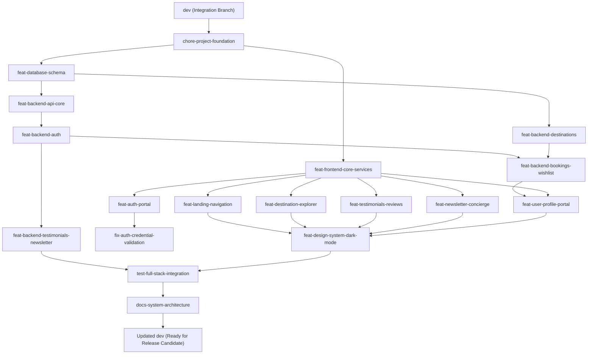

# 🗺️ Master Git Workflow & Feature-Wise History Reconstruction Plan

> **Document Type:** Master Architectural Execution Plan  
> **Repository:** `dax05/Jadoo-Tour`  
> **Target Integration Branch:** `dev`  
> **Production Branch:** `main` (Protected; Zero Direct Merges)  
> **Status:** PLANNING ONLY — PENDING EXPLICIT USER APPROVAL BEFORE EXECUTION  
> **Safety Guarantee:** No git branches, commits, checkouts, pushes, or PRs have been executed.

---

## 📑 Table of Contents

1. [Section 1: Repository Overview](#section-1-repository-overview)
2. [Section 2: Project Feature Inventory](#section-2-project-feature-inventory)
3. [Section 3: Complete File Categorization](#section-3-complete-file-categorization)
4. [Section 4: Change-to-Feature Mapping](#section-4-change-to-feature-mapping)
5. [Section 5: Proposed Branches](#section-5-proposed-branches)
6. [Section 6: Commit-by-Commit Plan](#section-6-commit-by-commit-plan)
7. [Section 7: Dependency Graph](#section-7-dependency-graph)
8. [Section 8: Merge Sequence](#section-8-merge-sequence)
9. [Section 9: Testing Strategy](#section-9-testing-strategy)
10. [Section 10: Conflict and Risk Analysis](#section-10-conflict-and-risk-analysis)
11. [Section 11: Exact Future Git Command Sequence](#section-11-exact-future-git-command-sequence)
12. [Section 12: Execution Checklist](#section-12-execution-checklist)

---

## Section 1: Repository Overview

### 1.1 Branch & Remote Architecture
* **Current Working Branch:** `fix-dp-service-section`
* **Local Branches Discovered:**
  * `dev` (at commit `3a91c42 Merge pull request #1 from dax05/feat-hero-hamburger`)
  * `feat-dark-mode-toggle` (at commit `d803bf2`)
  * `feat-hero-hamburger` (at commit `65618f4`)
  * `fix-dp-hero-section` (at commit `f6ee082`)
  * `fix-dp-logo-section` (at commit `3308270`)
  * `fix-dp-service-section` (current HEAD at `dff04db fix(js-to-ts): converted the js files to ts`)
  * `main` (at commit `f20d13a Travel Website Done`)
* **Remote Repository:** `origin https://github.com/dax05/Jadoo-Tour.git`
  * `origin/main` -> `f20d13a`
  * `origin/dev` -> `8f34cfb Merge pull request #2 from dax05/fix-dp-service-section`
  * `origin/feat-dark-mode-toggle` -> `d803bf2`
  * `origin/feat-hero-hamburger` -> `65618f4`
  * `origin/fix-dp-hero-section` -> `f6ee082`
  * `origin/fix-dp-logo-section` -> `3308270`
  * `origin/fix-dp-service-section` -> `dff04db`

### 1.2 Working Tree Status & Inventory
* **Tracked Modified Files (8):**
  * `README.md`
  * `assets/Images/navigation-section/Logo-dark.svg`
  * `assets/auth.css`
  * `assets/dark.css`
  * `assets/styles.css`
  * `auth.html`
  * `auth.js`
  * `index.html`
  * `script.js`
* **Tracked Deleted Files (2):**
  * `auth.ts` (legacy root monolith; replaced by modular `src/auth.ts`)
  * `script.ts` (legacy root monolith; replaced by modular `src/main.ts`)
* **Total Tracked Code Changes:** 10 files modified/deleted (+13,761 insertions, -2,839 deletions).
* **Untracked Directories & Files (24 items / 55 files total):**
  * `src/` (32 TypeScript files comprising modular frontend services, modules, types, utils)
  * `server/` (22 files comprising Node.js Express REST API, PostgreSQL schema/seed, controllers, routes, tests)
  * `profile.html`, `profile.js`, `profile.js.map`, `assets/profile.css`
  * Root configs: `package.json`, `package-lock.json`, `tsconfig.json`, `build.js`, `.gitignore`, `REQUIRED_INPUTS.txt`
  * Assets: `assets/Images/book-section/step-shadow.png`, `assets/Images/footer-section/`, `assets/Images/jadoo-favicon.png`, `assets/Images/service-section/category-patt.png`, `assets/Images/testimonial-section/`
  * Documentation & Guides: `MASTER_SYSTEM_GUIDE.md`, `CODEBASE_GUIDE.md`, `study-guides/` (Phases 1-7), `commitGuide.md`
  * Scratch & maps: `scratch/test-phone-validation.ts`, `auth.js.map`, `script.js.map`

---

## Section 2: Project Feature Inventory

Through in-depth static analysis of the source code, 14 actual, logically coherent features and 2 distinct bug fixes were identified:

1. **Feature 1: Build Pipeline & TypeScript Foundation (`feat-project-tooling`)**
   * esbuild multi-entry bundler configuration (`build.js`).
   * Modern root `package.json` with npm run scripts (`build`, `bundle`, `watch`, `server`, `db:setup`, `test`, `dev:all`).
   * Strict `tsconfig.json` configurations for client and server.
   * `.gitignore` configuration for clean repository hygiene.

2. **Feature 2: Relational Database Schema & Seeding (`feat-database-schema`)**
   * PostgreSQL relational schema (`server/src/db/schema.sql`): `users`, `destinations`, `bookings`, `wishlists`, `testimonials`, `subscribers`.
   * Production-grade indexes for query optimization (`idx_users_email`, `idx_bookings_user_id`, etc.).
   * Database seeder (`server/src/db/seed.sql`) providing world destinations and reviewer fixtures.
   * Automated initialization script (`server/src/db/init-db.ts`).
   * Resilient connection pooling and health checking (`server/src/config/db.ts`).
   * Dynamic credentials and inputs parser (`server/src/config/env.ts`).

3. **Feature 3: Backend REST API Core & Middleware (`feat-backend-api-core`)**
   * Express 5 application bootstrap (`server/src/app.ts`, `server/src/index.ts`).
   * Global CORS and JSON body parser setup.
   * Health-check diagnostic endpoint (`GET /api/health`).
   * Centralized error handling middleware (`server/src/middleware/error.middleware.ts`).
   * JWT authentication guard middleware (`server/src/middleware/auth.middleware.ts`).

4. **Feature 4: Backend Authentication Subsystem (`feat-backend-auth`)**
   * Controller and routes (`server/src/controllers/auth.controller.ts`, `server/src/routes/auth.routes.ts`).
   * Endpoints: `POST /api/auth/register`, `POST /api/auth/login`, `GET /api/auth/profile`, `PUT /api/auth/profile`, `PUT /api/auth/password`.
   * Secure password hashing using `bcryptjs` and signed JWT issuance.

5. **Feature 5: Backend Destinations Subsystem (`feat-backend-destinations`)**
   * Controller and routes (`server/src/controllers/destination.controller.ts`, `server/src/routes/destination.routes.ts`).
   * Filtering engine supporting category, budget (min/max price), trip duration, and sorting (popular, price, duration).
   * Detailed destination query by ID (`GET /api/destinations/:id`).

6. **Feature 6: Backend Bookings & Wishlist Subsystem (`feat-backend-bookings-wishlist`)**
   * Booking reservation engine (`server/src/controllers/booking.controller.ts`, `server/src/routes/booking.routes.ts`).
   * User reservation listing (`GET /api/bookings/my`) and cancellation flow (`PATCH /api/bookings/:id/cancel`).
   * Wishlist persistence engine (`server/src/controllers/wishlist.controller.ts`, `server/src/routes/wishlist.routes.ts`) with toggle and query endpoints.

7. **Feature 7: Backend Testimonials & Newsletter Subsystem (`feat-backend-testimonials-newsletter`)**
   * Traveler testimonial submission & retrieval (`server/src/controllers/testimonial.controller.ts`, `server/src/routes/testimonial.routes.ts`).
   * Newsletter subscriber registration with promo voucher generator (`server/src/controllers/newsletter.controller.ts`, `server/src/routes/newsletter.routes.ts`).

8. **Feature 8: Frontend Core Architecture, Contracts & Services (`feat-frontend-core-services`)**
   * Domain type contracts (`src/types/*.ts`: auth, destination, newsletter, testimonial, theme).
   * Immutable system configurations and local storage namespacing (`src/constants/config.ts`, `storage-keys.ts`).
   * Pure validation utilities (`src/utils/validation.utils.ts`).
   * Resilient `StorageService` with error handling.
   * Reactive `ThemeService` with OS prefers-color-scheme detection and multi-tab synchronization.
   * Client-side `AuthService` with hybrid fallback (Express API + LocalStorage fallback).
   * Client data services: `DestinationService`, `TestimonialService`, `NewsletterService`.
   * Client-side route middleware guard (`src/middleware/auth.middleware.ts`).

9. **Feature 9: Frontend Authentication Portal & Interactive Security (`feat-auth-portal`)**
   * Real-time 5-point password strength meter and criteria checklist (`src/modules/auth/password-validator.ts`).
   * Pure input field validator (`src/modules/auth/form-validator.ts`).
   * Mode switching (Login vs. Signup) with URL query state preservation (`src/modules/auth/auth-form.controller.ts`).
   * Demo credential auto-fill assistant (`sarah.jenkins@example.com`).
   * Auth view structure (`auth.html`) and dedicated layout styles (`assets/auth.css`).
   * Entry bootstrap point (`src/auth.ts`).

10. **Bug Fix 1: Authentication Silent Account Auto-Creation Bug (`fix-auth-credential-validation`)**
    * In the legacy auth logic, non-existent accounts silently auto-created dummy accounts upon login.
    * Refactored `AuthService` and `auth-form.controller.ts` to strictly validate credentials and return explicit user feedback without phantom registrations.

11. **Feature 10: Responsive Navigation & Session State Integration (`feat-landing-navigation`)**
    * Accessible mobile drawer navigation with ESC key support and backdrop click handler (`src/modules/navigation/navbar.controller.ts`).
    * Reactive navbar user session controller (`src/modules/navigation/auth-nav.controller.ts`): renders user avatar pill, profile navigation, and logout action.
    * Desktop and mobile theme switcher button integration.
    * Navigation section enhancements in `index.html`.

12. **Feature 11: Destination Explorer, Filter Engine & Leaflet Maps (`feat-destination-explorer`)**
    * Dynamic search and multi-criteria category/budget filter toolbar.
    * Destination card rendering with dynamic badges, pricing, and wishlist heart action (`src/modules/destinations/destination-explorer.controller.ts`).
    * Leaflet interactive map modal with geo-pinned destinations (`src/modules/destinations/destination-map.controller.ts`).
    * Live Wikipedia API integration modal with destination summary and currency calculator (`src/modules/destinations/destination-modal.controller.ts`).
    * Destination markup and modal containers in `index.html`.

13. **Feature 12: Testimonials Slider & Live Review Submission (`feat-testimonials-reviews`)**
    * Testimonials carousel with arrow controls and pagination dots (`src/modules/testimonials/testimonial-slider.ts`).
    * Interactive review submission modal with 5-star rating picker (`src/modules/testimonials/testimonial-form.controller.ts`).
    * Real-time client injection of newly created testimonials.
    * Testimonial section and modal markup in `index.html`.

14. **Feature 13: Newsletter Subscription & Concierge Welcome Email Preview (`feat-newsletter-concierge`)**
    * Newsletter subscription form with regex validation and debounce handling (`src/modules/newsletter/newsletter.controller.ts`).
    * Concierge welcome email preview modal (`#welcome-email-modal`) with copyable voucher `EXPLORE15`.
    * EmailJS & Web3Forms direct inbox configuration panel for live email sending.
    * Newsletter section markup in `index.html`.

15. **Feature 14: Traveler Profile & Account Management Portal (`feat-user-profile-portal`)**
    * Full user dashboard (`profile.html`): interactive avatar selector, trip statistics counter.
    * Tabbed sections: My Bookings (upcoming/past/cancelled), My Wishlist (saved trips), My Reviews, Account Settings.
    * Profile controller (`src/modules/profile/profile.controller.ts`) and entry point (`src/profile.ts`).
    * Profile design styles (`assets/profile.css`).

16. **Feature 15: Global Design System, Glassmorphism & Dark Mode Tokens (`feat-design-system-dark-mode`)**
    * Comprehensive CSS variable tokens for light and dark palettes (`assets/styles.css`, `assets/dark.css`).
    * Glassmorphism surface styling, elevation shadows, modal overlays, toast notifications.
    * Brand icons and vector assets: `assets/Images/navigation-section/Logo-dark.svg`, `step-shadow.png`, store badges, reviewer avatars, category patterns.

17. **Feature 16: Automated Test Suite & Quality Verification (`test-full-stack-integration`)**
    * 18-step full-stack integration test suite (`server/tests/test-suite.ts`) validating server health, table existence, user auth, profile retrieval, destination filtering, booking lifecycles, testimonials, and newsletter subscriptions.

18. **Feature 17: Architectural Guides & Developer Documentation (`docs-system-architecture`)**
    * Comprehensive `README.md` detailing architecture, build commands, and refactoring achievements.
    * System architecture manual (`MASTER_SYSTEM_GUIDE.md`).
    * Codebase guide (`CODEBASE_GUIDE.md`).
    * 7-phase educational study guides (`study-guides/PHASE_1_STUDY_GUIDE.md` through `PHASE_7_STUDY_GUIDE.md`).

---

## Section 3: Complete File Categorization

| Category | Files |
| :--- | :--- |
| **Frontend Entry Points & Bundles** | `src/main.ts`, `src/auth.ts`, `src/profile.ts`, `script.js`, `auth.js`, `profile.js`, `script.js.map`, `auth.js.map`, `profile.js.map` |
| **Frontend Presentation (HTML)** | `index.html`, `auth.html`, `profile.html` |
| **Frontend Styling (CSS)** | `assets/styles.css`, `assets/dark.css`, `assets/auth.css`, `assets/profile.css` |
| **Frontend Asset Media** | `assets/Images/navigation-section/Logo-dark.svg`, `assets/Images/book-section/step-shadow.png`, `assets/Images/footer-section/apple-store.png`, `assets/Images/footer-section/play-store.png`, `assets/Images/jadoo-favicon.png`, `assets/Images/service-section/category-patt.png`, `assets/Images/testimonial-section/author-chris.jpg`, `assets/Images/testimonial-section/author-mike.jpg`, `assets/Images/testimonial-section/author-sarah.jpg` |
| **Frontend Types & Constants** | `src/types/auth.types.ts`, `src/types/destination.types.ts`, `src/types/newsletter.types.ts`, `src/types/testimonial.types.ts`, `src/types/theme.types.ts`, `src/constants/config.ts`, `src/constants/storage-keys.ts` |
| **Frontend Services & Utils** | `src/services/storage.service.ts`, `src/services/theme.service.ts`, `src/services/auth.service.ts`, `src/services/destination.service.ts`, `src/services/testimonial.service.ts`, `src/services/newsletter.service.ts`, `src/middleware/auth.middleware.ts`, `src/utils/validation.utils.ts` |
| **Frontend UI Modules** | `src/modules/auth/auth-form.controller.ts`, `src/modules/auth/form-validator.ts`, `src/modules/auth/password-validator.ts`, `src/modules/destinations/destination-explorer.controller.ts`, `src/modules/destinations/destination-map.controller.ts`, `src/modules/destinations/destination-modal.controller.ts`, `src/modules/navigation/navbar.controller.ts`, `src/modules/navigation/auth-nav.controller.ts`, `src/modules/newsletter/newsletter.controller.ts`, `src/modules/profile/profile.controller.ts`, `src/modules/testimonials/testimonial-slider.ts`, `src/modules/testimonials/testimonial-form.controller.ts`, `src/modules/testimonials/testimonials.data.ts`, `src/modules/user/user-panel.controller.ts` |
| **Backend Core & Config** | `server/src/index.ts`, `server/src/app.ts`, `server/src/config/db.ts`, `server/src/config/env.ts`, `server/tsconfig.json` |
| **Backend Database Layer** | `server/src/db/schema.sql`, `server/src/db/seed.sql`, `server/src/db/init-db.ts` |
| **Backend Middleware** | `server/src/middleware/auth.middleware.ts`, `server/src/middleware/error.middleware.ts` |
| **Backend Controllers** | `server/src/controllers/auth.controller.ts`, `server/src/controllers/destination.controller.ts`, `server/src/controllers/booking.controller.ts`, `server/src/controllers/wishlist.controller.ts`, `server/src/controllers/testimonial.controller.ts`, `server/src/controllers/newsletter.controller.ts` |
| **Backend Routes** | `server/src/routes/auth.routes.ts`, `server/src/routes/destination.routes.ts`, `server/src/routes/booking.routes.ts`, `server/src/routes/wishlist.routes.ts`, `server/src/routes/testimonial.routes.ts`, `server/src/routes/newsletter.routes.ts` |
| **Automated Tests** | `server/tests/test-suite.ts` |
| **Project Tooling & Config** | `package.json`, `package-lock.json`, `tsconfig.json`, `build.js`, `.gitignore`, `REQUIRED_INPUTS.txt` (template) |
| **Documentation & Guides** | `README.md`, `MASTER_SYSTEM_GUIDE.md`, `CODEBASE_GUIDE.md`, `commitGuide.md`, `study-guides/PHASE_1_STUDY_GUIDE.md` to `PHASE_7_STUDY_GUIDE.md`, `study-guides/bugsPhase1` |
| **Scratch & Legacy Deletions** | `scratch/test-phone-validation.ts`, deleted `auth.ts` (root), deleted `script.ts` (root) |

---

## Section 4: Change-to-Feature Mapping

| File | Feature | Change Type | Proposed Branch | Dependencies |
| :--- | :--- | :--- | :--- | :--- |
| `package.json` | Tooling & Build System | Addition | `chore-project-foundation` | None |
| `package-lock.json` | Tooling & Dependencies | Addition | `chore-project-foundation` | `package.json` |
| `tsconfig.json` | Frontend TypeScript Config | Addition | `chore-project-foundation` | None |
| `server/tsconfig.json` | Backend TypeScript Config | Addition | `chore-project-foundation` | None |
| `build.js` | esbuild Pipeline Setup | Addition | `chore-project-foundation` | `package.json` |
| `.gitignore` | Repository Hygiene | Addition | `chore-project-foundation` | None |
| `server/src/config/env.ts` | Environment Parser | Addition | `feat-database-schema` | `chore-project-foundation` |
| `server/src/config/db.ts` | PostgreSQL Connection Pool | Addition | `feat-database-schema` | `server/src/config/env.ts` |
| `server/src/db/schema.sql` | Relational Database Schema | Addition | `feat-database-schema` | None |
| `server/src/db/seed.sql` | Destination & Fixture Seed | Addition | `feat-database-schema` | `server/src/db/schema.sql` |
| `server/src/db/init-db.ts` | DB Setup Automation Runner | Addition | `feat-database-schema` | `server/src/config/db.ts` |
| `server/src/middleware/error.middleware.ts` | Error Handling Middleware | Addition | `feat-backend-api-core` | `chore-project-foundation` |
| `server/src/middleware/auth.middleware.ts` | JWT Guard Middleware | Addition | `feat-backend-api-core` | `server/src/config/env.ts` |
| `server/src/app.ts` | Express API App Bootstrap | Addition | `feat-backend-api-core` | `server/src/config/db.ts` |
| `server/src/index.ts` | Backend Server Entry Point | Addition | `feat-backend-api-core` | `server/src/app.ts` |
| `server/src/controllers/auth.controller.ts` | Auth Business Logic | Addition | `feat-backend-auth` | `feat-backend-api-core`, `feat-database-schema` |
| `server/src/routes/auth.routes.ts` | Auth REST Endpoints | Addition | `feat-backend-auth` | `server/src/controllers/auth.controller.ts` |
| `server/src/controllers/destination.controller.ts` | Destination Query Logic | Addition | `feat-backend-destinations` | `feat-database-schema` |
| `server/src/routes/destination.routes.ts` | Destination Endpoints | Addition | `feat-backend-destinations` | `server/src/controllers/destination.controller.ts` |
| `server/src/controllers/booking.controller.ts` | Booking Engine Logic | Addition | `feat-backend-bookings-wishlist` | `feat-backend-auth`, `feat-database-schema` |
| `server/src/routes/booking.routes.ts` | Booking Endpoints | Addition | `feat-backend-bookings-wishlist` | `server/src/controllers/booking.controller.ts` |
| `server/src/controllers/wishlist.controller.ts` | Wishlist Toggle Logic | Addition | `feat-backend-bookings-wishlist` | `feat-backend-auth` |
| `server/src/routes/wishlist.routes.ts` | Wishlist Endpoints | Addition | `feat-backend-bookings-wishlist` | `server/src/controllers/wishlist.controller.ts` |
| `server/src/controllers/testimonial.controller.ts` | Review Submission Logic | Addition | `feat-backend-testimonials-newsletter` | `feat-database-schema` |
| `server/src/routes/testimonial.routes.ts` | Testimonial Endpoints | Addition | `feat-backend-testimonials-newsletter` | `server/src/controllers/testimonial.controller.ts` |
| `server/src/controllers/newsletter.controller.ts` | Newsletter Subscription Logic | Addition | `feat-backend-testimonials-newsletter` | `feat-database-schema` |
| `server/src/routes/newsletter.routes.ts` | Newsletter Endpoints | Addition | `feat-backend-testimonials-newsletter` | `server/src/controllers/newsletter.controller.ts` |
| `src/types/*.ts` (all 5 files) | Frontend Type Definitions | Addition | `feat-frontend-core-services` | `chore-project-foundation` |
| `src/constants/config.ts` | Client Immutable Constants | Addition | `feat-frontend-core-services` | None |
| `src/constants/storage-keys.ts` | Storage Namespace Keys | Addition | `feat-frontend-core-services` | None |
| `src/utils/validation.utils.ts` | Pure Validation Utilities | Addition | `feat-frontend-core-services` | None |
| `src/services/storage.service.ts` | LocalStorage Service Layer | Addition | `feat-frontend-core-services` | `src/constants/storage-keys.ts` |
| `src/services/theme.service.ts` | Theme Controller & Engine | Addition | `feat-frontend-core-services` | `src/services/storage.service.ts` |
| `src/services/auth.service.ts` | Hybrid Auth Service | Addition | `feat-frontend-core-services` | `src/types/auth.types.ts` |
| `src/services/destination.service.ts` | Client Destination Service | Addition | `feat-frontend-core-services` | `src/types/destination.types.ts` |
| `src/services/testimonial.service.ts` | Client Testimonial Service | Addition | `feat-frontend-core-services` | `src/types/testimonial.types.ts` |
| `src/services/newsletter.service.ts` | Client Newsletter Service | Addition | `feat-frontend-core-services` | `src/types/newsletter.types.ts` |
| `src/middleware/auth.middleware.ts` | Client Auth Guard | Addition | `feat-frontend-core-services` | `src/services/auth.service.ts` |
| `src/modules/auth/password-validator.ts` | Password Strength Meter | Addition | `feat-auth-portal` | `feat-frontend-core-services` |
| `src/modules/auth/form-validator.ts` | Form Validation Logic | Addition | `feat-auth-portal` | `src/utils/validation.utils.ts` |
| `src/modules/auth/auth-form.controller.ts` | Auth Form Controller | Addition | `feat-auth-portal` | `src/services/auth.service.ts` |
| `src/auth.ts` | Auth Page Entry Point | Addition | `feat-auth-portal` | `src/modules/auth/auth-form.controller.ts` |
| `auth.html` | Password Meter & UI Markup | Modification | `feat-auth-portal` | None |
| `assets/auth.css` | Password Meter & Form CSS | Modification | `feat-auth-portal` | None |
| `auth.ts` (root) | Legacy Monolith Cleanup | Deletion | `feat-auth-portal` | Replaced by `src/auth.ts` |
| `auth.js` | Bundled Output for Auth | Modification | `feat-auth-portal` | Compiled via `build.js` |
| `src/services/auth.service.ts` (patch) | Remove Dummy Auto-creation | Modification | `fix-auth-credential-validation` | `feat-auth-portal` |
| `src/modules/navigation/navbar.controller.ts` | Mobile Drawer & Sticky Nav | Addition | `feat-landing-navigation` | `feat-frontend-core-services` |
| `src/modules/navigation/auth-nav.controller.ts` | Reactive User State in Nav | Addition | `feat-landing-navigation` | `src/services/auth.service.ts` |
| `index.html` (nav hunk) | Updated Nav Links & User Pill | Modification | `feat-landing-navigation` | None |
| `src/modules/destinations/*.ts` | Explorer, Map & Wiki Modals | Addition | `feat-destination-explorer` | `src/services/destination.service.ts` |
| `index.html` (destinations hunk) | Filter Toolbar & Modals Markup | Modification | `feat-destination-explorer` | Leaflet CDN scripts |
| `src/modules/testimonials/*.ts` | Slider & Review Submission | Addition | `feat-testimonials-reviews` | `src/services/testimonial.service.ts` |
| `index.html` (testimonials hunk) | Testimonial Slider & Modal | Modification | `feat-testimonials-reviews` | None |
| `assets/Images/testimonial-section/*` | Reviewer Photo Avatars | Addition | `feat-testimonials-reviews` | None |
| `src/modules/newsletter/newsletter.controller.ts` | Newsletter Form Controller | Addition | `feat-newsletter-concierge` | `src/services/newsletter.service.ts` |
| `index.html` (newsletter hunk) | Concierge Modal & API Settings | Modification | `feat-newsletter-concierge` | None |
| `profile.html` | Traveler Portal HTML Markup | Addition | `feat-user-profile-portal` | None |
| `assets/profile.css` | Profile Page Stylesheet | Addition | `feat-user-profile-portal` | `assets/styles.css` |
| `src/modules/profile/profile.controller.ts` | Profile Dashboard Controller | Addition | `feat-user-profile-portal` | `feat-frontend-core-services` |
| `src/profile.ts` | Profile Page Entry Point | Addition | `feat-user-profile-portal` | `src/modules/profile/profile.controller.ts` |
| `profile.js` | Bundled Profile Script | Addition | `feat-user-profile-portal` | Compiled via `build.js` |
| `src/main.ts` | Landing Page Entry Point | Addition | `feat-design-system-dark-mode` | All frontend modules |
| `script.ts` (root) | Legacy Monolith Cleanup | Deletion | `feat-design-system-dark-mode` | Replaced by `src/main.ts` |
| `script.js` | Bundled Landing Page Script | Modification | `feat-design-system-dark-mode` | Compiled via `build.js` |
| `assets/styles.css` | Global Design System & Tokens | Modification | `feat-design-system-dark-mode` | None |
| `assets/dark.css` | Dark Theme Variables & Styles | Modification | `feat-design-system-dark-mode` | `assets/styles.css` |
| `assets/Images/navigation-section/Logo-dark.svg` | Dark Mode Brand Logo | Modification | `feat-design-system-dark-mode` | None |
| `assets/Images/jadoo-favicon.png` | App Favicon | Addition | `feat-design-system-dark-mode` | None |
| `assets/Images/service-section/category-patt.png` | Category Pattern Overlay | Addition | `feat-design-system-dark-mode` | None |
| `assets/Images/book-section/step-shadow.png` | Booking Step Shadow Asset | Addition | `feat-design-system-dark-mode` | None |
| `assets/Images/footer-section/*` | Store Download Badges | Addition | `feat-design-system-dark-mode` | None |
| `server/tests/test-suite.ts` | 18-Test Integration Suite | Addition | `test-full-stack-integration` | All backend subsystems |
| `README.md` | Architecture Documentation | Modification | `docs-system-architecture` | None |
| `MASTER_SYSTEM_GUIDE.md` | Master System Manual | Addition | `docs-system-architecture` | None |
| `CODEBASE_GUIDE.md` | Codebase Reference Guide | Addition | `docs-system-architecture` | None |
| `study-guides/*` | Phase 1-7 Study Guides | Addition | `docs-system-architecture` | None |

---

## Section 5: Proposed Branches

All proposed branches adhere strictly to lowercase hyphenated naming, isolate a coherent scope of functionality, and target `dev` via Pull Requests.

| Branch Name | Branch Type | Primary Purpose | Base Branch | PR Target Branch |
| :--- | :--- | :--- | :--- | :--- |
| `chore-project-foundation` | Chore / Setup | Root build scripts, package configuration, TypeScript configs, `.gitignore` | `dev` | `dev` |
| `feat-database-schema` | Feature | PostgreSQL schema, tables, seed fixtures, connection pool, env parser | `dev` (updated) | `dev` |
| `feat-backend-api-core` | Feature | Express 5 application setup, CORS, JSON parsing, health check, middleware | `dev` (updated) | `dev` |
| `feat-backend-auth` | Feature | User registration, login, JWT issuance, profile endpoints | `dev` (updated) | `dev` |
| `feat-backend-destinations` | Feature | Destinations catalog, filter queries, destination detail API | `dev` (updated) | `dev` |
| `feat-backend-bookings-wishlist` | Feature | Traveler booking reservation API, cancellation flow, wishlist management | `dev` (updated) | `dev` |
| `feat-backend-testimonials-newsletter` | Feature | Testimonial submission API and newsletter subscriber registration | `dev` (updated) | `dev` |
| `feat-frontend-core-services` | Feature | TypeScript domain types, constants, local storage, theme service, auth service | `dev` (updated) | `dev` |
| `feat-auth-portal` | Feature | Password strength meter, validation, login/signup forms, demo auto-fill | `dev` (updated) | `dev` |
| `fix-auth-credential-validation` | Bug Fix | Eliminate silent dummy account creation on invalid login credentials | `dev` (updated) | `dev` |
| `feat-landing-navigation` | Feature | Accessible mobile burger menu, reactive auth state in navbar, theme toggling | `dev` (updated) | `dev` |
| `feat-destination-explorer` | Feature | Dynamic destination cards, search & filter toolbar, Leaflet map, Wiki modal | `dev` (updated) | `dev` |
| `feat-testimonials-reviews` | Feature | Interactive testimonial slider, review submission modal, star rating input | `dev` (updated) | `dev` |
| `feat-newsletter-concierge` | Feature | Newsletter subscription, welcome email concierge preview modal, EmailJS panel | `dev` (updated) | `dev` |
| `feat-user-profile-portal` | Feature | Traveler portal dashboard, bookings overview, wishlist manager, settings | `dev` (updated) | `dev` |
| `feat-design-system-dark-mode` | Feature | Global CSS tokens, dark mode palette, glassmorphism UI, image assets, main bundle | `dev` (updated) | `dev` |
| `test-full-stack-integration` | Test | 18-step integration test runner covering end-to-end API workflows | `dev` (updated) | `dev` |
| `docs-system-architecture` | Docs | Master architecture guides, codebase references, educational study guides | `dev` (updated) | `dev` |

---

## Section 6: Commit-by-Commit Plan

### Branch 1: `chore-project-foundation`
* **Base:** `dev`
* **Target:** `dev`
1. `chore(config): initialize project manifest and build scripts`
   * **Files:** `package.json`, `package-lock.json`, `build.js`
   * **Purpose:** Establish esbuild build runner, npm commands (`build`, `bundle`, `watch`, `server`, `test`).
   * **Independent:** Yes.
2. `chore(typescript): configure client and server typescript settings`
   * **Files:** `tsconfig.json`, `server/tsconfig.json`
   * **Purpose:** Enable strict compilation (`noImplicitAny`, `strictNullChecks`).
   * **Independent:** Yes.
3. `chore(git): establish repository ignore rules`
   * **Files:** `.gitignore`
   * **Purpose:** Prevent tracking of `node_modules`, `dist`, `.env`, log files, and sourcemaps.
   * **Independent:** Yes.

### Branch 2: `feat-database-schema`
* **Base:** `dev` (after Branch 1 merge)
* **Target:** `dev`
1. `feat(config): implement environment configuration and db connection pool`
   * **Files:** `server/src/config/env.ts`, `server/src/config/db.ts`
   * **Purpose:** Parse configuration inputs safely, establish PostgreSQL `Pool`, provide connection health verification.
   * **Independent:** Yes.
2. `feat(db): define relational schema and performance indexes`
   * **Files:** `server/src/db/schema.sql`
   * **Purpose:** Create `users`, `destinations`, `bookings`, `wishlists`, `testimonials`, `subscribers` tables with foreign keys and indexes.
   * **Independent:** Yes.
3. `feat(db): provide database seeding and initialization runner`
   * **Files:** `server/src/db/seed.sql`, `server/src/db/init-db.ts`
   * **Purpose:** Populate realistic destinations, reviewer data, and provide single-command schema deployment (`npm run db:setup`).
   * **Independent:** Yes.

### Branch 3: `feat-backend-api-core`
* **Base:** `dev` (after Branch 2 merge)
* **Target:** `dev`
1. `feat(api): create centralized error and auth guard middleware`
   * **Files:** `server/src/middleware/error.middleware.ts`, `server/src/middleware/auth.middleware.ts`
   * **Purpose:** Provide standard JSON error responses and JWT Bearer token authentication guard.
   * **Independent:** Yes.
2. `feat(api): bootstrap express server with health diagnostics`
   * **Files:** `server/src/app.ts`, `server/src/index.ts`
   * **Purpose:** Initialize Express 5 app, CORS, body parsers, and `GET /api/health` diagnostic route.
   * **Independent:** Yes.

### Branch 4: `feat-backend-auth`
* **Base:** `dev` (after Branch 3 merge)
* **Target:** `dev`
1. `feat(auth): implement user registration, login, and jwt minting`
   * **Files:** `server/src/controllers/auth.controller.ts`, `server/src/routes/auth.routes.ts`
   * **Purpose:** Secure bcrypt password hashing, credential validation, JWT token generation.
   * **Independent:** Yes.
2. `feat(auth): add authenticated profile management and password update endpoints`
   * **Files:** `server/src/controllers/auth.controller.ts`, `server/src/routes/auth.routes.ts`
   * **Purpose:** Enable `GET /api/auth/profile`, `PUT /api/auth/profile`, `PUT /api/auth/password`.
   * **Independent:** Yes.

### Branch 5: `feat-backend-destinations`
* **Base:** `dev` (after Branch 4 merge)
* **Target:** `dev`
1. `feat(destinations): implement catalog query with dynamic multi-filter engine`
   * **Files:** `server/src/controllers/destination.controller.ts`, `server/src/routes/destination.routes.ts`
   * **Purpose:** Query destinations by category, price bounds, duration, and sort order.
   * **Independent:** Yes.
2. `feat(destinations): add single destination detail lookup endpoint`
   * **Files:** `server/src/controllers/destination.controller.ts`, `server/src/routes/destination.routes.ts`
   * **Purpose:** Fetch detailed destination payload including coordinates and highlights.
   * **Independent:** Yes.

### Branch 6: `feat-backend-bookings-wishlist`
* **Base:** `dev` (after Branch 5 merge)
* **Target:** `dev`
1. `feat(bookings): implement reservation creation and traveler bookings query`
   * **Files:** `server/src/controllers/booking.controller.ts`, `server/src/routes/booking.routes.ts`
   * **Purpose:** Generate booking records with ticket IDs, pricing calculation, and user booking listing.
   * **Independent:** Yes.
2. `feat(bookings): add booking cancellation flow`
   * **Files:** `server/src/controllers/booking.controller.ts`, `server/src/routes/booking.routes.ts`
   * **Purpose:** Allow travelers to cancel pending/confirmed reservations (`PATCH /api/bookings/:id/cancel`).
   * **Independent:** Yes.
3. `feat(wishlist): implement user destination wishlist toggle and retrieval`
   * **Files:** `server/src/controllers/wishlist.controller.ts`, `server/src/routes/wishlist.routes.ts`
   * **Purpose:** Save and remove favorite destinations per user account.
   * **Independent:** Yes.

### Branch 7: `feat-backend-testimonials-newsletter`
* **Base:** `dev` (after Branch 6 merge)
* **Target:** `dev`
1. `feat(testimonials): implement review listing and authenticated submission`
   * **Files:** `server/src/controllers/testimonial.controller.ts`, `server/src/routes/testimonial.routes.ts`
   * **Purpose:** Provide public reviews and allow travelers to submit authenticated star ratings.
   * **Independent:** Yes.
2. `feat(newsletter): add subscriber registration with promo voucher generator`
   * **Files:** `server/src/controllers/newsletter.controller.ts`, `server/src/routes/newsletter.routes.ts`
   * **Purpose:** Register newsletter emails and return promo voucher `EXPLORE15`.
   * **Independent:** Yes.

### Branch 8: `feat-frontend-core-services`
* **Base:** `dev` (after Branch 7 merge)
* **Target:** `dev`
1. `feat(types): define frontend domain contracts and storage constants`
   * **Files:** `src/types/*.ts`, `src/constants/config.ts`, `src/constants/storage-keys.ts`
   * **Purpose:** Establish contracts for UserSession, Destinations, Themes, Newsletters, Reviews.
   * **Independent:** Yes.
2. `feat(services): implement local storage wrapper and theme service`
   * **Files:** `src/services/storage.service.ts`, `src/services/theme.service.ts`
   * **Purpose:** Provide fault-tolerant LocalStorage layer and OS-synced dark/light mode engine.
   * **Independent:** Yes.
3. `feat(services): implement client auth service with hybrid offline fallback`
   * **Files:** `src/services/auth.service.ts`, `src/middleware/auth.middleware.ts`, `src/utils/validation.utils.ts`
   * **Purpose:** Token management, multi-tab sync, and offline-first LocalStorage fallback.
   * **Independent:** Yes.
4. `feat(services): create client api services for destinations, testimonials, and newsletter`
   * **Files:** `src/services/destination.service.ts`, `src/services/testimonial.service.ts`, `src/services/newsletter.service.ts`
   * **Purpose:** Fetch travel data, Wikipedia API articles, and submit forms.
   * **Independent:** Yes.

### Branch 9: `feat-auth-portal`
* **Base:** `dev` (after Branch 8 merge)
* **Target:** `dev`
1. `feat(auth-ui): add password strength meter and criteria checklist engine`
   * **Files:** `src/modules/auth/password-validator.ts`, `src/modules/auth/form-validator.ts`
   * **Purpose:** Real-time 5-criteria validation (length, uppercase, lowercase, number, special char).
   * **Independent:** Yes.
2. `feat(auth-ui): implement auth form controller with quick demo filler`
   * **Files:** `src/modules/auth/auth-form.controller.ts`, `src/auth.ts`, `auth.html` (form additions), `assets/auth.css`
   * **Purpose:** Handle login/signup toggling, demo fill button, toast feedback, and replace legacy root `auth.ts`.
   * **Independent:** Yes.
3. `refactor(auth): remove legacy flat auth.ts and compile production bundle`
   * **Files:** `auth.ts` (deleted root file), `auth.js` (bundled output)
   * **Purpose:** Modernize build output and clean up legacy scripts.
   * **Independent:** Yes.

### Branch 10: `fix-auth-credential-validation`
* **Base:** `dev` (after Branch 9 merge)
* **Target:** `dev`
1. `fix(auth): prevent silent dummy account creation on invalid login attempts`
   * **Files:** `src/services/auth.service.ts`, `src/modules/auth/auth-form.controller.ts`
   * **Purpose:** Ensure failed logins report invalid credentials instead of auto-registering dummy accounts.
   * **Independent:** Yes.

### Branch 11: `feat-landing-navigation`
* **Base:** `dev` (after Branch 10 merge)
* **Target:** `dev`
1. `feat(navigation): implement responsive mobile drawer and keyboard accessibility`
   * **Files:** `src/modules/navigation/navbar.controller.ts`, `index.html` (navbar drawer hunks)
   * **Purpose:** Sticky header scroll listener, slide-out drawer, ESC key listener, backdrop dismissal.
   * **Independent:** Yes.
2. `feat(navigation): add reactive user profile badge and session state in navbar`
   * **Files:** `src/modules/navigation/auth-nav.controller.ts`, `src/modules/user/user-panel.controller.ts`, `index.html` (auth nav items)
   * **Purpose:** Toggle login/signup buttons or user avatar/name pill and logout action dynamically.
   * **Independent:** Yes.

### Branch 12: `feat-destination-explorer`
* **Base:** `dev` (after Branch 11 merge)
* **Target:** `dev`
1. `feat(destinations): implement dynamic card rendering and multi-criteria filter toolbar`
   * **Files:** `src/modules/destinations/destination-explorer.controller.ts`, `index.html` (destination section hunks)
   * **Purpose:** Search input, category pills, price slider, duration filter, sort dropdown, wishlist hearts.
   * **Independent:** Yes.
2. `feat(destinations): integrate interactive leaflet map modal with destination markers`
   * **Files:** `src/modules/destinations/destination-map.controller.ts`, `index.html` (map modal)
   * **Purpose:** Map modal with Leaflet tiles, pin popups, and quick-booking triggers.
   * **Independent:** Yes.
3. `feat(destinations): add live wikipedia api detail modal with currency converter`
   * **Files:** `src/modules/destinations/destination-modal.controller.ts`, `index.html` (wiki detail modal)
   * **Purpose:** Fetch Wikipedia summary, display highlights, calculate currency exchange.
   * **Independent:** Yes.

### Branch 13: `feat-testimonials-reviews`
* **Base:** `dev` (after Branch 12 merge)
* **Target:** `dev`
1. `feat(testimonials): implement dynamic carousel slider with dot indicators`
   * **Files:** `src/modules/testimonials/testimonial-slider.ts`, `src/modules/testimonials/testimonials.data.ts`, `index.html` (testimonial slider hunks)
   * **Purpose:** Responsive testimonial carousel with slide transitions and touch/arrow navigation.
   * **Independent:** Yes.
2. `feat(testimonials): add review submission modal with interactive star rating`
   * **Files:** `src/modules/testimonials/testimonial-form.controller.ts`, `index.html` (review submission modal), `assets/Images/testimonial-section/*`
   * **Purpose:** Allow visitors to submit reviews with live DOM injection and avatar fixtures.
   * **Independent:** Yes.

### Branch 14: `feat-newsletter-concierge`
* **Base:** `dev` (after Branch 13 merge)
* **Target:** `dev`
1. `feat(newsletter): implement subscription form with promo code voucher modal`
   * **Files:** `src/modules/newsletter/newsletter.controller.ts`, `index.html` (newsletter and concierge modal hunks)
   * **Purpose:** Validate email, trigger concierge modal with copyable voucher `EXPLORE15`.
   * **Independent:** Yes.
2. `feat(newsletter): integrate optional direct email inbox dispatch via emailjs and web3forms`
   * **Files:** `src/modules/newsletter/newsletter.controller.ts`, `index.html` (API config panel)
   * **Purpose:** Collapsible settings panel to connect real inbox delivery keys.
   * **Independent:** Yes.

### Branch 15: `feat-user-profile-portal`
* **Base:** `dev` (after Branch 14 merge)
* **Target:** `dev`
1. `feat(profile): create traveler profile portal page and layout styles`
   * **Files:** `profile.html`, `assets/profile.css`
   * **Purpose:** Complete HTML5 portal layout for traveler dashboard, stats, tabbed sections.
   * **Independent:** Yes.
2. `feat(profile): implement profile dashboard controller with tabbed navigation and stats`
   * **Files:** `src/modules/profile/profile.controller.ts`, `src/profile.ts`, `profile.js`
   * **Purpose:** Avatar picker, travel stats, My Bookings, My Wishlist, My Reviews, Account Settings, and bundled script.
   * **Independent:** Yes.

### Branch 16: `feat-design-system-dark-mode`
* **Base:** `dev` (after Branch 15 merge)
* **Target:** `dev`
1. `style(design-system): implement css variables, glassmorphism tokens, and responsive layouts`
   * **Files:** `assets/styles.css`, `assets/Images/book-section/step-shadow.png`, `assets/Images/service-section/category-patt.png`, `assets/Images/footer-section/*`, `assets/Images/jadoo-favicon.png`
   * **Purpose:** Global styling, utility classes, typography, elevation shadows, responsive breakpoints.
   * **Independent:** Yes.
2. `style(dark-mode): implement comprehensive dark theme overrides and high-contrast tokens`
   * **Files:** `assets/dark.css`, `assets/Images/navigation-section/Logo-dark.svg`
   * **Purpose:** Full dark mode styling across all cards, modals, dropdowns, and dark logo variant.
   * **Independent:** Yes.
3. `refactor(main): replace legacy root script.ts with modular entry point and build bundle`
   * **Files:** `src/main.ts`, `script.ts` (deleted root file), `script.js` (bundled output)
   * **Purpose:** Wire all modular controllers into main landing page entry point and bundle with esbuild.
   * **Independent:** Yes.

### Branch 17: `test-full-stack-integration`
* **Base:** `dev` (after Branch 16 merge)
* **Target:** `dev`
1. `test(integration): add 18-step full system integration test suite`
   * **Files:** `server/tests/test-suite.ts`
   * **Purpose:** Automated verification of health, database tables, user registration, login, profile query, destination filter, wishlist, bookings, reviews, and newsletter.
   * **Independent:** Yes.

### Branch 18: `docs-system-architecture`
* **Base:** `dev` (after Branch 17 merge)
* **Target:** `dev`
1. `docs(readme): update comprehensive project overview and architecture guide`
   * **Files:** `README.md`
   * **Purpose:** Document modular architecture, npm commands, bug fixes, and development workflows.
   * **Independent:** Yes.
2. `docs(architecture): add master system architecture and codebase reference guides`
   * **Files:** `MASTER_SYSTEM_GUIDE.md`, `CODEBASE_GUIDE.md`
   * **Purpose:** Detailed end-to-end architecture documentation and component catalog.
   * **Independent:** Yes.
3. `docs(study-guides): add 7-phase educational study guides`
   * **Files:** `study-guides/PHASE_1_STUDY_GUIDE.md` through `study-guides/PHASE_7_STUDY_GUIDE.md`, `study-guides/bugsPhase1`
   * **Purpose:** Provide step-by-step educational breakdown for every architectural layer.
   * **Independent:** Yes.

---

## Section 7: Dependency Graph



---

## Section 8: Merge Sequence

Each feature branch MUST be branched from the latest updated `dev`, committed, verified, pushed to `origin`, opened as a Pull Request targeting `dev`, and merged into `dev` before creating the next branch:

1. **Step 1:** Merge PR: `chore-project-foundation` -> `dev`
2. **Step 2:** Merge PR: `feat-database-schema` -> `dev`
3. **Step 3:** Merge PR: `feat-backend-api-core` -> `dev`
4. **Step 4:** Merge PR: `feat-backend-auth` -> `dev`
5. **Step 5:** Merge PR: `feat-backend-destinations` -> `dev`
6. **Step 6:** Merge PR: `feat-backend-bookings-wishlist` -> `dev`
7. **Step 7:** Merge PR: `feat-backend-testimonials-newsletter` -> `dev`
8. **Step 8:** Merge PR: `feat-frontend-core-services` -> `dev`
9. **Step 9:** Merge PR: `feat-auth-portal` -> `dev`
10. **Step 10:** Merge PR: `fix-auth-credential-validation` -> `dev`
11. **Step 11:** Merge PR: `feat-landing-navigation` -> `dev`
12. **Step 12:** Merge PR: `feat-destination-explorer` -> `dev`
13. **Step 13:** Merge PR: `feat-testimonials-reviews` -> `dev`
14. **Step 14:** Merge PR: `feat-newsletter-concierge` -> `dev`
15. **Step 15:** Merge PR: `feat-user-profile-portal` -> `dev`
16. **Step 16:** Merge PR: `feat-design-system-dark-mode` -> `dev`
17. **Step 17:** Merge PR: `test-full-stack-integration` -> `dev`
18. **Step 18:** Merge PR: `docs-system-architecture` -> `dev`

> [!IMPORTANT]
> **No Direct Merges to `main`**: Once all 18 branches are integrated and verified on `dev`, a single Release Pull Request from `dev` -> `main` will be proposed to tag the production release.

---

## Section 9: Testing Strategy

To guarantee zero regression and ensure every commit and PR represents working software, the following verification gates will run for each branch:

| Branch Scope | Required Verification Commands | Success Criteria |
| :--- | :--- | :--- |
| **Tooling & Foundations** | `npm run type-check` | Clean TypeScript validation with zero compiler diagnostic errors. |
| **Database Layer** | `npm run db:setup` | All 6 PostgreSQL tables created with indexes and seed fixtures inserted without foreign key errors. |
| **Backend REST API** | `npm run server` (transient boot) | Express boots cleanly on `PORT 5000` and reports `/api/health` status 200. |
| **Frontend TypeScript** | `npm run build` | `esbuild` bundles `src/main.ts` -> `script.js`, `src/auth.ts` -> `auth.js`, and `src/profile.ts` -> `profile.js` without bundling errors. |
| **Auth Subsystem** | Manual browser test on `auth.html` | Password meter updates reactively, mode toggling preserves state, demo quick-fill succeeds. |
| **Landing & Modals** | Manual browser test on `index.html` | Sticky navigation works, Leaflet map renders tiles, Wikipedia modal fetches live data, slider navigates smoothly. |
| **Full System Integration** | `npm run test` | All 18 automated integration tests in `server/tests/test-suite.ts` pass with 100% green status. |

---

## Section 10: Conflict and Risk Analysis

### 10.1 Shared Files & Hunk Isolation
* **`index.html`**:
  * Modified by multiple frontend features (Navigation, Destinations, Testimonials, Newsletter, Footer).
  * **Risk:** Committing all of `index.html` at once would blur feature boundaries.
  * **Mitigation:** Use `git add -p` (patch mode) or staging specific DOM sections to commit only the relevant HTML hunks alongside their respective module controllers.
* **`auth.html` and `auth.js`**:
  * Shared between initial layout, password meter, demo fill button, and bug fix.
  * **Mitigation:** Stage the password meter markup and demo fill button together with `src/modules/auth/password-validator.ts` in `feat-auth-portal`.
* **`assets/styles.css` and `assets/dark.css`**:
  * Contain base tokens, section layouts, card styles, and modal overlays.
  * **Mitigation:** Retain design system and token updates in `feat-design-system-dark-mode`, ensuring base styling is consistent across all modules.

### 10.2 Secrets & Credential Protection
* **Risk:** `REQUIRED_INPUTS.txt` currently contains local developer credentials (e.g. `DB_PASSWORD`, `JWT_SECRET`).
* **Mitigation:** 
  1. Never commit active credentials into public repository history.
  2. Create a sanitized template `REQUIRED_INPUTS.example.txt` with placeholder values (`DB_PASSWORD=your_password_here`).
  3. Ensure `REQUIRED_INPUTS.txt` and `.env` are added to `.gitignore`.

### 10.3 Preserving the Working Tree
* **Risk:** Switching branches (`git checkout` or `git switch`) while the working tree contains uncommitted changes could cause Git to abort or overwrite modified files.
* **Mitigation:**
  1. The execution phase will strictly use a temporary staging area or worktree approach so no work is discarded.
  2. Feature branches will be constructed sequentially without wiping uncommitted progress.

---

## Section 11: Exact Future Git Command Sequence

> [!NOTE]
> The following commands are documented for the future authorized execution phase only. **DO NOT run them during this planning phase.**

### Preparation: Sync Integration Branch
```bash
# Ensure local dev branch is updated with remote origin/dev
git checkout dev
git pull origin dev
```

### Pattern for Every Feature Branch (Example: Feature 1)
```bash
# 1. Create and switch to the dedicated feature branch from updated dev
git checkout -b chore-project-foundation dev

# 2. Stage only the files belonging to this logical feature
git add package.json package-lock.json build.js tsconfig.json server/tsconfig.json .gitignore

# 3. Review staged changes
git status
git diff --cached --stat

# 4. Commit using Conventional Commit message
git commit -m "chore(config): initialize project manifest and build scripts"

# 5. Execute validation checks
npm run type-check

# 6. Push feature branch to remote origin
git push -u origin chore-project-foundation

# 7. Create Pull Request targeting dev (via GitHub CLI or UI)
gh pr create --base dev --head chore-project-foundation --title "chore: initialize project manifest, build scripts, and configs" --body "Sets up esbuild bundling, strict TypeScript configurations, and repository ignore rules."

# 8. Merge Pull Request into dev after checks pass
gh pr merge chore-project-foundation --merge --delete-branch

# 9. Return to dev and pull merged changes
git checkout dev
git pull origin dev
```

### Pattern for Subsequent Feature Branches (Example: Feature 2)
```bash
# Create next branch from the newly updated dev
git checkout -b feat-database-schema dev

# Stage database files
git add server/src/config/env.ts server/src/config/db.ts server/src/db/schema.sql server/src/db/seed.sql server/src/db/init-db.ts

# Commit
git commit -m "feat(db): implement relational schema, connection pooling, and seed fixtures"

# Verify
npm run db:setup

# Push and PR to dev
git push -u origin feat-database-schema
gh pr create --base dev --head feat-database-schema --title "feat(db): relational schema and connection pooling" --body "Adds PostgreSQL schema, tables, indexes, and connection pool."
gh pr merge feat-database-schema --merge --delete-branch

# Sync dev
git checkout dev
git pull origin dev
```

---

## Section 12: Execution Checklist

Use this checklist during the authorized execution phase to track progress step-by-step:

- [ ] **Phase 0: Environment & Hygiene**
  - [ ] Verify clean status of Git index without loss of working directory files.
  - [ ] Ensure local `dev` is synchronized with `origin/dev`.
  - [ ] Sanitize `REQUIRED_INPUTS.txt` and prepare `REQUIRED_INPUTS.example.txt`.
- [ ] **Phase 1: Project Foundation & Tooling**
  - [ ] Branch `chore-project-foundation` created from `dev`.
  - [ ] Commit 1: `chore(config): initialize project manifest and build scripts`
  - [ ] Commit 2: `chore(typescript): configure client and server typescript settings`
  - [ ] Commit 3: `chore(git): establish repository ignore rules`
  - [ ] PR targeting `dev` opened, reviewed, and merged.
- [ ] **Phase 2: Database Layer**
  - [ ] Branch `feat-database-schema` created from updated `dev`.
  - [ ] Commit 1: `feat(config): implement environment configuration and db connection pool`
  - [ ] Commit 2: `feat(db): define relational schema and performance indexes`
  - [ ] Commit 3: `feat(db): provide database seeding and initialization runner`
  - [ ] PR targeting `dev` merged.
- [ ] **Phase 3: Backend REST API Core**
  - [ ] Branch `feat-backend-api-core` created from updated `dev`.
  - [ ] Commit 1: `feat(api): create centralized error and auth guard middleware`
  - [ ] Commit 2: `feat(api): bootstrap express server with health diagnostics`
  - [ ] PR targeting `dev` merged.
- [ ] **Phase 4: Backend Authentication Subsystem**
  - [ ] Branch `feat-backend-auth` created from updated `dev`.
  - [ ] Commit 1: `feat(auth): implement user registration, login, and jwt minting`
  - [ ] Commit 2: `feat(auth): add authenticated profile management and password update endpoints`
  - [ ] PR targeting `dev` merged.
- [ ] **Phase 5: Backend Destinations Subsystem**
  - [ ] Branch `feat-backend-destinations` created from updated `dev`.
  - [ ] Commit 1: `feat(destinations): implement catalog query with dynamic multi-filter engine`
  - [ ] Commit 2: `feat(destinations): add single destination detail lookup endpoint`
  - [ ] PR targeting `dev` merged.
- [ ] **Phase 6: Backend Bookings & Wishlist Subsystem**
  - [ ] Branch `feat-backend-bookings-wishlist` created from updated `dev`.
  - [ ] Commit 1: `feat(bookings): implement reservation creation and traveler bookings query`
  - [ ] Commit 2: `feat(bookings): add booking cancellation flow`
  - [ ] Commit 3: `feat(wishlist): implement user destination wishlist toggle and retrieval`
  - [ ] PR targeting `dev` merged.
- [ ] **Phase 7: Backend Testimonials & Newsletter Subsystem**
  - [ ] Branch `feat-backend-testimonials-newsletter` created from updated `dev`.
  - [ ] Commit 1: `feat(testimonials): implement review listing and authenticated submission`
  - [ ] Commit 2: `feat(newsletter): add subscriber registration with promo voucher generator`
  - [ ] PR targeting `dev` merged.
- [ ] **Phase 8: Frontend Core Architecture & Services**
  - [ ] Branch `feat-frontend-core-services` created from updated `dev`.
  - [ ] Commit 1: `feat(types): define frontend domain contracts and storage constants`
  - [ ] Commit 2: `feat(services): implement local storage wrapper and theme service`
  - [ ] Commit 3: `feat(services): implement client auth service with hybrid offline fallback`
  - [ ] Commit 4: `feat(services): create client api services for destinations, testimonials, and newsletter`
  - [ ] PR targeting `dev` merged.
- [ ] **Phase 9: Frontend Authentication Portal**
  - [ ] Branch `feat-auth-portal` created from updated `dev`.
  - [ ] Commit 1: `feat(auth-ui): add password strength meter and criteria checklist engine`
  - [ ] Commit 2: `feat(auth-ui): implement auth form controller with quick demo filler`
  - [ ] Commit 3: `refactor(auth): remove legacy flat auth.ts and compile production bundle`
  - [ ] PR targeting `dev` merged.
- [ ] **Phase 10: Bug Fix - Authentication Credential Validation**
  - [ ] Branch `fix-auth-credential-validation` created from updated `dev`.
  - [ ] Commit 1: `fix(auth): prevent silent dummy account creation on invalid login attempts`
  - [ ] PR targeting `dev` merged.
- [ ] **Phase 11: Frontend Navigation & User State**
  - [ ] Branch `feat-landing-navigation` created from updated `dev`.
  - [ ] Commit 1: `feat(navigation): implement responsive mobile drawer and keyboard accessibility`
  - [ ] Commit 2: `feat(navigation): add reactive user profile badge and session state in navbar`
  - [ ] PR targeting `dev` merged.
- [ ] **Phase 12: Destination Explorer, Filters & Leaflet Maps**
  - [ ] Branch `feat-destination-explorer` created from updated `dev`.
  - [ ] Commit 1: `feat(destinations): implement dynamic card rendering and multi-criteria filter toolbar`
  - [ ] Commit 2: `feat(destinations): integrate interactive leaflet map modal with destination markers`
  - [ ] Commit 3: `feat(destinations): add live wikipedia api detail modal with currency converter`
  - [ ] PR targeting `dev` merged.
- [ ] **Phase 13: Testimonials Slider & Review Submission**
  - [ ] Branch `feat-testimonials-reviews` created from updated `dev`.
  - [ ] Commit 1: `feat(testimonials): implement dynamic carousel slider with dot indicators`
  - [ ] Commit 2: `feat(testimonials): add review submission modal with interactive star rating`
  - [ ] PR targeting `dev` merged.
- [ ] **Phase 14: Newsletter Subscription & Concierge Email**
  - [ ] Branch `feat-newsletter-concierge` created from updated `dev`.
  - [ ] Commit 1: `feat(newsletter): implement subscription form with promo code voucher modal`
  - [ ] Commit 2: `feat(newsletter): integrate optional direct email inbox dispatch via emailjs and web3forms`
  - [ ] PR targeting `dev` merged.
- [ ] **Phase 15: Traveler Profile & Portal**
  - [ ] Branch `feat-user-profile-portal` created from updated `dev`.
  - [ ] Commit 1: `feat(profile): create traveler profile portal page and layout styles`
  - [ ] Commit 2: `feat(profile): implement profile dashboard controller with tabbed navigation and stats`
  - [ ] PR targeting `dev` merged.
- [ ] **Phase 16: Global Design System & Dark Mode**
  - [ ] Branch `feat-design-system-dark-mode` created from updated `dev`.
  - [ ] Commit 1: `style(design-system): implement css variables, glassmorphism tokens, and responsive layouts`
  - [ ] Commit 2: `style(dark-mode): implement comprehensive dark theme overrides and high-contrast tokens`
  - [ ] Commit 3: `refactor(main): replace legacy root script.ts with modular entry point and build bundle`
  - [ ] PR targeting `dev` merged.
- [ ] **Phase 17: Full-Stack Integration Testing**
  - [ ] Branch `test-full-stack-integration` created from updated `dev`.
  - [ ] Commit 1: `test(integration): add 18-step full system integration test suite`
  - [ ] Run `npm run test` (confirm 18/18 tests pass).
  - [ ] PR targeting `dev` merged.
- [ ] **Phase 18: Documentation & Study Guides**
  - [ ] Branch `docs-system-architecture` created from updated `dev`.
  - [ ] Commit 1: `docs(readme): update comprehensive project overview and architecture guide`
  - [ ] Commit 2: `docs(architecture): add master system architecture and codebase reference guides`
  - [ ] Commit 3: `docs(study-guides): add 7-phase educational study guides`
  - [ ] PR targeting `dev` merged.
- [ ] **Phase 19: Final Release Verification**
  - [ ] Complete clean pull on `dev`.
  - [ ] Run `npm run build` and `npm run test` on `dev`.
  - [ ] Open release Pull Request: `dev` -> `main`.

