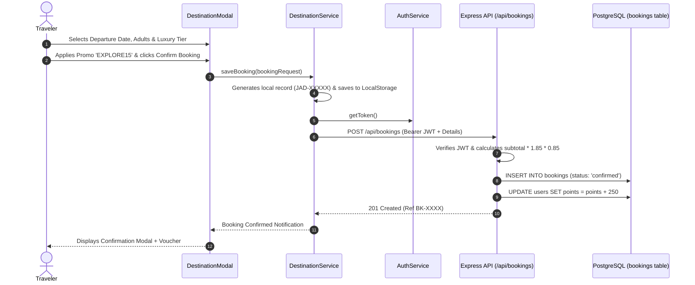

# 🌍 Jadoo Travel — Master System Architecture & Codebase Guide

> **A Complete, End-to-End Architectural Manual for the Full-Stack Jadoo Travel Application.**  
> Built with: **Vanilla HTML5 + Vanilla CSS3 (with Dark Mode Tokens) + TypeScript + esbuild + Node.js + Express + PostgreSQL + JWT Authentication + Leaflet Maps + Wikipedia Live API + EmailJS Concierge**.

---

## 📑 Table of Contents

1. [Executive Architecture Overview](#1-executive-architecture-overview)
2. [Root Directory & Project Configurations](#2-root-directory--project-configurations)
3. [HTML Web Pages & Presentation Layer](#3-html-web-pages--presentation-layer)
4. [CSS Styling System & Design Tokens](#4-css-styling-system--design-tokens)
5. [Frontend TypeScript Architecture (`src/`)](#5-frontend-typescript-architecture-src)
   - 5.1 [Application Entry Points](#51-application-entry-points)
   - 5.2 [Constants & Storage Keys](#52-constants--storage-keys)
   - 5.3 [TypeScript Type Contracts (`src/types/`)](#53-typescript-type-contracts-srctypes)
   - 5.4 [Client-Side Services (`src/services/`)](#54-client-side-services-srcservices)
   - 5.5 [Client Middleware (`src/middleware/`)](#55-client-middleware-srcmiddleware)
   - 5.6 [Feature Modules (`src/modules/`)](#56-feature-modules-srcmodules)
6. [Backend Node.js & Express REST API (`server/`)](#6-backend-nodejs--express-rest-api-server)
   - 6.1 [Server Entry & App Bootstrap](#61-server-entry--app-bootstrap)
   - 6.2 [Environment & Database Pooling](#62-environment--database-pooling)
   - 6.3 [Database Schema & Migrations (`server/src/db/`)](#63-database-schema--migrations-serversrcdb)
   - 6.4 [Authentication & Security Middleware](#64-authentication--security-middleware)
   - 6.5 [Controllers & Business Logic (`server/src/controllers/`)](#65-controllers--business-logic-serversrccontrollers)
   - 6.6 [API Routes (`server/src/routes/`)](#66-api-routes-serversrcroutes)
   - 6.7 [System Test Suite (`server/tests/`)](#67-system-test-suite-servertests)
7. [Data Flow & Lifecycle Sequences](#7-data-flow--lifecycle-sequences)
8. [NPM Scripts & Operational Cheatsheet](#8-npm-scripts--operational-cheatsheet)

---

## 1. Executive Architecture Overview

Jadoo Travel follows a **modern decoupled full-stack architecture** optimized for ultra-high performance, zero bloated frameworks, strict type safety, and resilient offline-first data synchronization:

```
┌────────────────────────────────────────────────────────────────────────┐
│                        BROWSER PRESENTATION LAYER                      │
│   index.html (Landing)  │  auth.html (Auth)  │  profile.html (Portal)  │
│          Vanilla CSS (Light/Dark Tokens) + Leaflet Interactive Map      │
└──────────────────────────────────┬─────────────────────────────────────┘
                                   │
                                   ▼
┌────────────────────────────────────────────────────────────────────────┐
│                   FRONTEND TYPESCRIPT CLIENT LAYER                     │
│  Controllers (Modules) ──► Services (Auth, Dest, Theme, Storage)       │
│                                  │                                     │
│         ┌────────────────────────┴───────────────────────┐             │
│         ▼                                                ▼             │
│   LocalStorage Cache (Offline)                  REST API Client        │
└──────────────────────────────────────────────────────────┬─────────────┘
                                                           │ HTTP / JWT
                                                           ▼
┌────────────────────────────────────────────────────────────────────────┐
│                   EXPRESS REST API BACKEND LAYER                       │
│    App (CORS, JSON Parser) ──► Routers ──► Auth Middleware (JWT)       │
│                                                   │                    │
│                                            Controllers                 │
│                          (Auth, Booking, Dest, Wishlist, Reviews, News)│
└──────────────────────────────────┬─────────────────────────────────────┘
                                   │
                                   ▼
┌────────────────────────────────────────────────────────────────────────┐
│                       POSTGRESQL DATABASE LAYER                        │
│   Users │ Destinations │ Bookings │ Wishlists │ Reviews │ Subscribers  │
└────────────────────────────────────────────────────────────────────────┘
```

### Key Architectural Principles:
1. **Resilient Hybrid Fallback**: The client talks to the Express/PostgreSQL API via JWT. If the backend is temporarily offline, the frontend seamlessly degrades to `localStorage`, so the UI never crashes or hangs.
2. **Zero-Lockin Vanilla CSS**: Ultra-fast rendering with pure CSS custom properties (`--primary`, `--bg-dark`, etc.), avoiding bulky CSS framework dependencies.
3. **Strict Type Safety**: Both frontend and backend are independently typed with TypeScript compiler flags (`noImplicitAny`, `strictNullChecks`, `noUnusedLocals`).

---

## 2. Root Directory & Project Configurations

### `REQUIRED_INPUTS.txt`
- **Duty**: The central user-facing configuration file for database credentials, ports, and secret keys.
- **Importance**: The backend's `env.ts` parser directly reads this file on boot. Users do not need to memorize shell environment variables or touch `.env`.
- **Key Sections**:
  - `DATABASE_URL`: Cloud connection string (Neon, Supabase, Render).
  - `DB_HOST`, `DB_PORT`, `DB_USER`, `DB_PASSWORD`, `DB_NAME`: Local PostgreSQL parameters.
  - `PORT`, `JWT_SECRET`: Server application settings.

### `package.json`
- **Duty**: Declares NPM dependencies, metadata, and developer workflows.
- **Importance**: Provides single-command execution for building, running, and testing both client and server.
- **Key Scripts**:
  - `"build"`: Runs `tsc --noEmit` and bundles `build.js`.
  - `"watch"`: Launches `build.js --watch` for hot rebuilding of frontend scripts.
  - `"server"`: Starts `tsx watch server/src/index.ts` with auto-reload on backend changes.
  - `"db:setup"`: Runs `tsx server/src/db/init-db.ts` to execute schema and seed tables.
  - `"test"`: Runs `tsx server/tests/test-suite.ts` (18 full-stack integration tests).
  - `"dev:all"`: Concurrently runs frontend watch and backend watch simultaneously.

### `tsconfig.json`
- **Duty**: Configures frontend TypeScript compilation.
- **Importance**: Enforces strict code quality (`noUnusedLocals: true`, `noUnusedParameters: true`) and targets ES2022 with DOM typing.

### `build.js`
- **Duty**: Bundles the modular frontend TypeScript code into production-ready standalone scripts using `esbuild`.
- **Importance**: Compiles `src/main.ts` -> `script.js`, `src/auth.ts` -> `auth.js`, and `src/profile.ts` -> `profile.js` in milliseconds with source maps.

### `.gitignore`
- **Duty**: Prevents sensitive files (`.env`), build directories (`dist/`, `server/dist/`), `node_modules/`, and logs from being tracked by Git.

---

## 3. HTML Web Pages & Presentation Layer

### `index.html` (Landing Page & Discovery Portal)
- **Duty**: The primary public-facing portal where travelers explore destinations, browse curated packages, preview locations on interactive maps, read testimonials, and subscribe to newsletters.
- **Core Sections**:
  1. `<nav class="navbar">`: Responsive sticky navbar with logo, smooth-scroll links, theme toggle, and authenticated user avatar badge.
  2. `<section class="hero">`: Hero visual banner with animated flight decorative trails, booking CTA, and play demo modal button.
  3. `<section class="services">`: Four core value pillars (Calculated Weather, Best Flights, Local Events, Customization).
  4. `<section class="destinations" id="destinations-section">`: Destination Explorer with interactive category filters, live Wikipedia search bar, and grid of destination cards.
  5. `<section class="book-steps">`: 3-step booking walkthrough alongside the interactive "Trip to Greece" card with favorite heart toggle.
  6. `<section id="destinations-map-wrapper">`: Live interactive Leaflet map rendering customizable pins for all world destinations.
  7. `<section class="testimonials">`: Card slider featuring verified traveler reviews and a "Share Your Story" modal button.
  8. `<section class="newsletter">`: Floating curved newsletter subscription box with EmailJS integration and instant VIP voucher delivery.
  9. `<footer class="footer">`: Navigation columns, social media links, and copyright notices.
  10. `<aside id="user-portal-drawer">`: Slide-out panel for quickly viewing favorited wishlist items and active bookings without leaving the page.
  11. `<div id="destination-modal">`: Comprehensive booking dialog for selecting dates, travelers, package tiers (Standard, Deluxe, Luxury), and applying promo codes.

### `auth.html` (Authentication & Security Portal)
- **Duty**: Handles traveler onboarding and identity verification.
- **Importance**: Provides a dual-mode (Login / Sign Up) form with live interactive validation, password security metering, and redirect-memory (returns users to where they started).
- **Core Sections**:
  1. `.auth-card-banner`: Split-card visual backdrop with dynamic branding.
  2. `.auth-tabs`: Tab switchers (`Sign In` vs `Create Account`).
  3. `.auth-form`: Floating-label inputs for Name, Email, Password, and Confirm Password with eye toggles for password visibility.
  4. `#password-strength-container`: Visual progress meter checking length (8+), uppercase, lowercase, numbers, and special symbols.
  5. `#auth-alert`: Dynamic notification banner for feedback on success/failure.

### `profile.html` (Traveler Dashboard & Account Settings)
- **Duty**: Protected traveler account hub where users inspect active bookings, manage wishlists, update passport/dietary preferences, and accrue loyalty points.
- **Core Sections**:
  1. `.profile-sidebar`: Traveler avatar, full name, email, loyalty tier badge (`Gold Adventurer`), and navigation tabs (`Overview`, `My Bookings`, `Wishlist`, `Settings`).
  2. `#tab-overview`: Visual metric cards displaying Total Trips, Reward Points, Favorite Places, and Travel Style.
  3. `#tab-bookings`: Real-time list of confirmed, completed, and cancelled bookings with a one-click "Cancel Reservation" action.
  4. `#tab-wishlist`: Grid of favorited destination cards with direct "Book Now" shortcuts.
  5. `#tab-settings`: Edit profile details (Phone, City, Passport, Travel Style, Seat Preference) and password change form.

---

## 4. CSS Styling System & Design Tokens

### `assets/styles.css`
- **Duty**: Foundation styling system for the entire application.
- **Design Tokens**: Defined in `:root` with CSS custom properties (`--primary-color: #DF6951`, `--secondary-color: #F1A501`, `--text-dark: #181E4B`, `--font-poppins`, `--font-volkhov`).
- **Features**: Fluid CSS Grid, Flexbox layouts, decorative SVG blobs, card hover elevations, and responsive breakpoints (`@media (max-width: 991px)` and `768px`).

### `assets/dark.css`
- **Duty**: Comprehensive dark mode token overrides.
- **Mechanism**: Triggered by `data-theme="dark"` attribute on `<html>`. Replaces white surfaces with deep dark blues (`#0f172a`, `#1e293b`), softens high-contrast text, adjusts card shadows, and updates Leaflet map tile brightness.

### `assets/auth.css`
- **Duty**: High-end styling specifically crafted for `auth.html`.
- **Features**: Glassmorphic panels, animated validation status rings (green/red borders), loading spinner button states, and password strength gauge transitions.

### `assets/profile.css`
- **Duty**: Dashboard presentation styles for `profile.html`.
- **Features**: Status chips (`confirmed`, `cancelled`), responsive booking cards, metric counter cards, and tabs switching animation.

---

## 5. Frontend TypeScript Architecture (`src/`)

### 5.1 Application Entry Points

- **`src/main.ts`**:
  - Initializes `ThemeService.bindToggleButtons()`.
  - Instantiates `NavbarController`, `AuthNavController`.
  - Instantiates `DestinationModalController`, `DestinationMapController`, `DestinationExplorerController`.
  - Instantiates `UserPanelController` (slide-over drawer).
  - Instantiates `TestimonialSlider`, `TestimonialFormController`.
  - Instantiates `NewsletterController`.
  - Invokes `DestinationService.syncWithBackend()` and `testimonialService.syncWithBackend()` to pull latest PostgreSQL records.
- **`src/auth.ts`**:
  - Bootstraps `ThemeService`.
  - Instantiates `AuthFormController` to drive login and signup flows.
- **`src/profile.ts`**:
  - Bootstraps `ThemeService`.
  - Invokes `DestinationService.syncWithBackend()`.
  - Instantiates `ProfileController` to render bookings, wishlists, and account preferences.

---

### 5.2 Constants & Storage Keys

- **`src/constants/config.ts`**:
  - `ASSET_PATHS`: Relative image paths for logos and brand marks.
  - `API_CONFIG`: Backend connection coordinates (`BASE_URL: 'http://localhost:5000/api'`, `TIMEOUT_MS: 5000`).
  - `UI_CONFIG`: Navbar scroll threshold (50px), redirect delay (1200ms).
  - `VALIDATION_RULES`: Regex patterns for emails, names, and password min-lengths.
  - `EMAIL_SERVICE_CONFIG`: EmailJS Service ID, Template ID, Public Key, and VIP voucher promo code (`EXPLORE15`).
- **`src/constants/storage-keys.ts`**:
  - `STORAGE_KEYS`: Namespaced keys (`jadoo_user_session`, `jadoo_auth_token`, `jadoo_bookings`, `jadoo_favorites`, `jadoo_theme`, etc.) preventing storage collision.

---

### 5.3 TypeScript Type Contracts (`src/types/`)

- **`auth.types.ts`**: Defines `UserAccount`, `UserSession`, `AuthResponse`, and `AuthMode`.
- **`destination.types.ts`**: Defines `Destination`, `BookingRequest`, `BookingRecord`, and `PackageTier`.
- **`newsletter.types.ts`**: Defines `NewsletterSubscriber`, `SendEmailResult`, and `EmailApiConfig`.
- **`testimonial.types.ts`**: Defines `Testimonial` contract.
- **`theme.types.ts`**: Defines `'light' | 'dark'` theme modes.

---

### 5.4 Client-Side Services (`src/services/`)

#### `auth.service.ts` (`AuthService`)
- **Duty**: Singleton managing user sessions, JWT token persistence, and authentication API round-trips.
- **Key Methods**:
  - `register(name, email, password)`: Sends `POST /api/auth/register`. On success, saves JWT and returns `AuthResponse`. Falls back to local storage if API is offline.
  - `login(email, password)`: Sends `POST /api/auth/login`. On success, saves JWT to `STORAGE_KEYS.AUTH_TOKEN` and updates active session.
  - `logout()`: Clears session and auth token from storage and notifies listeners.
  - `getToken()`: Retrieves active JWT string.
  - `getCurrentSession()`: Returns current user object.
  - `updateProfile(updatedData)`: Persists traveler preferences locally and to the backend.

#### `destination.service.ts` (`DestinationService`)
- **Duty**: Manages curated destination seeds, live Wikipedia search, bookings CRUD, wishlist favorites, and PostgreSQL synchronization.
- **Key Methods**:
  - `getInitialDestinations()`: Fetches or returns cached seed destinations (Rome, London, Tokyo, Bali, etc.).
  - `searchDestinations(query)`: Queries the free live Wikipedia API (`api/rest_v1/page/summary` and `w/api.php?action=query`) with scenic photo filtering and duration estimation.
  - `saveBooking(req)`: Saves booking into local storage, notifies UI listeners, and asynchronously sends `POST /api/bookings` with JWT.
  - `cancelBooking(bookingId)`: Marks booking cancelled locally and sends `PATCH /api/bookings/:id/cancel`.
  - `toggleFavorite(destOrId)`: Toggles favorite ID, saves to wishlist, and sends `POST /api/wishlist/toggle`.
  - `syncWithBackend()`: Pulls user bookings from `GET /api/bookings/my-bookings` and favorites from `GET /api/wishlist`, merging them into local storage.

#### `newsletter.service.ts` (`NewsletterService`)
- **Duty**: Handles newsletter sign-ups, VIP promo code assignment (`EXPLORE15`), live EmailJS dispatch, and backend subscriber recording.
- **Key Methods**:
  - `subscribe(email, name)`: Saves subscriber locally, dispatches live welcome email via EmailJS REST API, and syncs to `POST /api/newsletter/subscribe`.
  - `generateWelcomeMessage(name, promoCode)`: Generates luxury concierge greeting message.

#### `testimonial.service.ts` (`TestimonialService`)
- **Duty**: Manages testimonials feed, allowing travelers to submit new reviews.
- **Key Methods**:
  - `getAllTestimonials()`: Merges default curated reviews with traveler-submitted ones.
  - `addTestimonial(data)`: Saves review, updates listeners, and syncs to `POST /api/testimonials`.
  - `syncWithBackend()`: Pulls approved reviews from `GET /api/testimonials`.

#### `theme.service.ts` (`ThemeService`)
- **Duty**: Coordinates light and dark mode toggling.
- **Key Methods**:
  - `initTheme()`: Reads saved theme from storage or detects OS preference (`prefers-color-scheme`).
  - `toggleTheme()`: Toggles between light and dark, sets `data-theme` on `<html>`, and updates theme button icons.

#### `storage.service.ts` (`StorageService`)
- **Duty**: Safe wrapper around `window.localStorage` with JSON serialization and try/catch protection against storage quota errors.

---

### 5.5 Client Middleware (`src/middleware/`)

#### `auth.middleware.ts` (`AuthMiddleware`)
- **Duty**: Client-side navigation guards and action gates.
- **Key Methods**:
  - `requireAuth(returnUrl)`: Checks if user is authenticated; if not, redirects to `auth.html?mode=login&returnUrl=...`.
  - `redirectIfAuthenticated(destinationUrl)`: Prevents already-signed-in users from seeing the login screen.
  - `gateActionWithAuth(actionCallback, returnUrl)`: Executes action if logged in, or opens sign-in if not.

---

### 5.6 Feature Modules (`src/modules/`)

- **`navigation/navbar.controller.ts`**: Listens to window scroll events to add `.is-scrolled` frosted-glass styling to navbar and controls mobile menu open/close states.
- **`navigation/auth-nav.controller.ts`**: Subscribes to `AuthService`. When authenticated, replaces the generic "Login / Sign up" navbar button with the traveler's avatar, name, and profile dropdown link.
- **`auth/auth-form.controller.ts`**: Handles tab switches, submits registration or login asynchronously, triggers password validation visual feedback, and remembers email when checked.
- **`auth/form-validator.ts`**: Performs synchronous field validation for names and emails using regex rules.
- **`auth/password-validator.ts`**: Evaluates passwords against 5 security criteria and returns percentage score and error list.
- **`destinations/destination-explorer.controller.ts`**: Binds category filter buttons (All, Europe, Asia, Americas, Africa), debounces search input, and renders destination cards with image fallback handling.
- **`destinations/destination-modal.controller.ts`**: Renders trip booking dialog with adult/child counters, date picker, tier multipliers, promo code verification, and price recalculation.
- **`destinations/destination-map.controller.ts`**: Initializes Leaflet map with custom marker icons, centering on coordinates when cards are clicked.
- **`user/user-panel.controller.ts`**: Controls the slide-out quick panel displaying wishlist items and confirmed reservations.
- **`profile/profile.controller.ts`**: Populates the profile page with traveler metrics, manages tab navigation, handles profile edits, password changes, and booking cancellations.
- **`testimonials/testimonial-slider.ts`**: Drives the interactive carousel card slider with smooth slide animations and dot indicators.
- **`testimonials/testimonial-form.controller.ts`**: Opens the "Share Your Story" modal and validates review submission.
- **`newsletter/newsletter.controller.ts`**: Validates newsletter email input, triggers loading state, and displays status alerts.

---

## 6. Backend Node.js & Express REST API (`server/`)

### 6.1 Server Entry & App Bootstrap

- **`server/src/app.ts`**:
  - Creates Express app instance.
  - Configures `cors({ origin: '*' })` and `express.json()`.
  - Mounts health check endpoint `GET /api/health`.
  - Mounts all feature routes (`/api/auth`, `/api/destinations`, `/api/bookings`, `/api/wishlist`, `/api/testimonials`, `/api/newsletter`).
  - Registers `errorHandler` middleware.
- **`server/src/index.ts`**:
  - Imports `app` and `ENV`.
  - Calls `checkDatabaseConnection()` to verify PostgreSQL availability.
  - Starts listening on `http://localhost:5000`.

---

### 6.2 Environment & Database Pooling

- **`server/src/config/env.ts`**:
  - Checks for `REQUIRED_INPUTS.txt` at the root and parses key/value pairs.
  - Falls back to `server/.env` or system environment variables.
  - Exports typed `ENV` object (`PORT`, `JWT_SECRET`, `DB_HOST`, `DB_PASSWORD`, `DATABASE_URL`, etc.).
- **`server/src/config/db.ts`**:
  - Creates a PostgreSQL connection pool (`new Pool(...)`) with automatic SSL detection.
  - Exports `pool` and `checkDatabaseConnection()`.

---

### 6.3 Database Schema & Migrations (`server/src/db/`)

- **`schema.sql`**:
  - `users`: ID, name, email (unique), password_hash (bcrypt), role, bio, home_city, points, travel preferences.
  - `destinations`: ID (slug), title, country, price_usd, duration_days, rating, image_url, latitude, longitude.
  - `bookings`: ID (`BK-XXXX`), user_id (FK), destination_id (FK), departure_date, adults, children, package_tier, total_price, promo_code, status.
  - `wishlists`: ID, user_id (FK), destination_id (FK), saved_at. Unique constraint on `(user_id, destination_id)`.
  - `testimonials`: ID, user_id (FK), author_name, location, quote, rating, is_approved.
  - `subscribers`: ID, email (unique), name, promo_code, subscribed_at.
- **`seed.sql`**:
  - Seeds demo user `sarah.jenkins@example.com` (password: `Traveler123!`).
  - Seeds 6 destinations (Rome, London, Full Europe, Santorini, Bali, Tokyo).
  - Seeds initial reviews and confirmed booking.
- **`init-db.ts`**:
  - Automated runner (`npm run db:setup`) reading and executing `schema.sql` and `seed.sql`.

---

### 6.4 Authentication & Security Middleware

- **`server/src/middleware/auth.middleware.ts`**:
  - `requireAuth`: Reads `Authorization: Bearer <token>` header, verifies JWT using `JWT_SECRET`, and attaches decoded user to `req.user`. Returns 401 if missing or invalid.
  - `optionalAuth`: Verifies token if provided, but does not block request if absent.
- **`server/src/middleware/error.middleware.ts`**:
  - Global catch-all handler returning clean JSON error responses instead of stack traces.

---

### 6.5 Controllers & Business Logic (`server/src/controllers/`)

- **`auth.controller.ts`**:
  - `register`: Validates email uniqueness, hashes password with `bcryptjs` (10 rounds), inserts user, and mints JWT.
  - `login`: Compares bcrypt hash, generates JWT on match, and returns sanitized profile.
  - `getProfile`: Returns authenticated user's profile and loyalty points.
  - `updateProfile`: Updates traveler phone, home city, passport number, and travel style.
- **`destination.controller.ts`**:
  - `getAll`: Returns list of curated destinations from PostgreSQL.
  - `getById`: Returns specific destination by ID.
- **`booking.controller.ts`**:
  - `create`: Calculates tier multiplier (Deluxe = 1.35x, Luxury = 1.85x), validates promo code `EXPLORE15` (15% discount), inserts booking record, and awards 250 loyalty points to traveler. Auto-stubs custom destination entries.
  - `getUserBookings`: Returns all trip reservations for authenticated user.
  - `cancel`: Sets booking status to `'cancelled'`.
- **`wishlist.controller.ts`**:
  - `getWishlist`: Returns user's saved destinations.
  - `toggle`: Adds item if absent, removes if present. Auto-inserts unknown search destination IDs to ensure foreign key integrity.
  - `clear`: Empties user's saved wishlist.
- **`testimonial.controller.ts`**:
  - `getAll`: Returns approved reviews sorted by date.
  - `create`: Submits a traveler review.
- **`newsletter.controller.ts`**:
  - `subscribe`: Records newsletter subscriber and assigns `EXPLORE15` discount code.

---

### 6.6 API Routes (`server/src/routes/`)

| Method | Endpoint | Protection | Controller Action |
| :--- | :--- | :--- | :--- |
| `GET` | `/api/health` | Public | Server & DB health check |
| `POST` | `/api/auth/register` | Public | Register new user & issue JWT |
| `POST` | `/api/auth/login` | Public | Authenticate user & issue JWT |
| `GET` | `/api/auth/profile` | **Bearer JWT** | Get current user profile |
| `PUT` | `/api/auth/profile` | **Bearer JWT** | Update traveler preferences |
| `GET` | `/api/destinations` | Public | List all destinations |
| `GET` | `/api/destinations/:id`| Public | Get destination details |
| `POST` | `/api/bookings` | **Bearer JWT** | Create booking & award points |
| `GET` | `/api/bookings` | **Bearer JWT** | List user bookings |
| `GET` | `/api/bookings/my-bookings` | **Bearer JWT** | List user bookings (alias) |
| `PATCH`| `/api/bookings/:id/cancel` | **Bearer JWT** | Cancel trip reservation |
| `GET` | `/api/wishlist` | **Bearer JWT** | List favorited destinations |
| `POST` | `/api/wishlist/toggle` | **Bearer JWT** | Toggle favorite in wishlist |
| `DELETE`| `/api/wishlist` | **Bearer JWT** | Clear user wishlist |
| `GET` | `/api/testimonials` | Public | List traveler reviews |
| `POST` | `/api/testimonials` | Optional Auth | Submit traveler review |
| `POST` | `/api/newsletter/subscribe` | Public | Subscribe to newsletter |

---

### 6.7 System Test Suite (`server/tests/`)

- **`server/tests/test-suite.ts`**:
  - Self-contained 18-step integration test runner executed via `npm test`.
  - Verifies:
    1. Server health check (`/api/health`)
    2. Existence of all 6 PostgreSQL tables
    3. User registration & JWT generation
    4. Successful login
    5. Rejection of incorrect password (401)
    6. Authenticated profile retrieval
    7. Destination catalog retrieval
    8. Destination query by ID
    9. Wishlist toggle add
    10. Wishlist verification
    11. Wishlist toggle remove
    12. Trip booking creation with tier and promo calculation
    13. Loyalty points increment (+250 points)
    14. My-Bookings retrieval
    15. Booking cancellation
    16. Testimonial submission
    17. Testimonial feed integration
    18. Newsletter VIP subscription and voucher generation

---

## 7. Data Flow & Lifecycle Sequences

### User Booking Lifecycle Sequence


---

## 8. NPM Scripts & Operational Cheatsheet

| Command | Purpose |
| :--- | :--- |
| **`npm run dev:all`** | Runs both frontend watch bundler and backend watch server concurrently. |
| **`npm run server`** | Starts backend Express API on `http://localhost:5000` with hot restart. |
| **`npm run db:setup`** | Connects to PostgreSQL, builds tables, and inserts initial seeds. |
| **`npm test`** | Executes the 18-step system integration test suite. |
| **`npm run build`** | Runs TypeScript compiler checks and compiles production bundles. |
| **`npm run watch`** | Watches frontend `src/` files and recompiles `script.js`, `auth.js`, `profile.js`. |

---

### Demo Traveler Account Credentials
- **Email:** `sarah.jenkins@example.com`
- **Password:** `Traveler123!`
- **Role:** Explorer / Adventurer (1,850 Loyalty Points)
- **VIP Voucher Code:** `EXPLORE15` (15% discount on all bookings)
