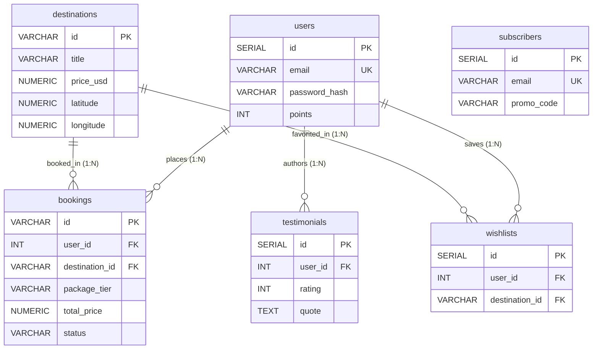

# 🗄️ Jadoo Travel — Phase 2 Study Guide: The Database Layer (PostgreSQL)

> **Phase 2 Learning Objective:** Master relational schema design, data modeling, foreign key constraints, financial numeric precision, idempotent seeding, and automated database migrations using PostgreSQL.  
> **Philosophy:** *“Code comes and goes, but data outlives applications. A well-designed schema is the single most valuable asset in any software system.”*

---

## 📑 Phase 2 Navigation Map

1. [Architectural Overview: The Entity-Relationship Model](#1-architectural-overview-the-entity-relationship-model)
2. [File 1: `server/src/db/schema.sql` — Relational DDL & Constraints](#file-1-serversrcdbschemasql--relational-ddl--constraints)
   - 2.1 [Table 1: `users` (Authentication & Traveler Profiles)](#21-table-1-users-authentication--traveler-profiles)
   - 2.2 [Table 2: `destinations` (World Trips, Pricing & GPS Coordinates)](#22-table-2-destinations-world-trips-pricing--gps-coordinates)
   - 2.3 [Table 3: `bookings` (Reservations & Ticket Lifecycle)](#23-table-3-bookings-reservations--ticket-lifecycle)
   - 2.4 [Table 4: `wishlists` (Many-to-Many User Favorites)](#24-table-4-wishlists-many-to-many-user-favorites)
   - 2.5 [Table 5: `testimonials` (Traveler Reviews & Ratings)](#25-table-5-testimonials-traveler-reviews--ratings)
   - 2.6 [Table 6: `subscribers` (Newsletter Registry)](#26-table-6-subscribers-newsletter-registry)
   - 2.7 [Performance Indexing Strategies (`CREATE INDEX`)](#27-performance-indexing-strategies-create-index)
3. [File 2: `server/src/db/seed.sql` — Idempotent Mock & Initial Data](#file-2-serversrcdbseedsql--idempotent-mock--initial-data)
   - 3.1 [Demo User & Bcrypt Salt Breakdown](#31-demo-user--bcrypt-salt-breakdown)
   - 3.2 [World Destination Seeds & PostgreSQL `ARRAY[...]` Types](#32-world-destination-seeds--postgresql-array-types)
   - 3.3 [Dynamic Date Arithmetic & Foreign Key Binding](#33-dynamic-date-arithmetic--foreign-key-binding)
4. [File 3: `server/src/db/init-db.ts` — Automated Migration Runner](#file-3-serversrcdbinit-dbts--automated-migration-runner)
   - 4.1 [Script Architecture & Connection Pooling](#41-script-architecture--connection-pooling)
   - 4.2 [Client Acquisition, Execution & Graceful Shutdown](#42-client-acquisition-execution--graceful-shutdown)
5. [Deep-Dive Conceptual Callouts](#5-deep-dive-conceptual-callouts)
   - 5.1 [Why `NUMERIC(10, 2)` instead of `FLOAT` for Currency?](#51-why-numeric10-2-instead-of-float-for-currency)
   - 5.2 [Referential Actions: `ON DELETE CASCADE` vs `ON DELETE SET NULL`](#52-referential-actions-on-delete-cascade-vs-on-delete-set-null)
   - 5.3 [GPS Coordinate Precision: `NUMERIC(9, 6)`](#53-gps-coordinate-precision-numeric9-6)
   - 5.4 [Idempotency & the `EXCLUDED` Pseudo-Table](#54-idempotency--the-excluded-pseudo-table)
6. [Self-Check Mastery Quiz](#6-self-check-mastery-quiz)

---

## 1. Architectural Overview: The Entity-Relationship Model

Jadoo Travel's database uses **6 relational tables** designed to normal forms (3NF) to avoid duplication while maintaining fast query performance for traveler dashboards:



---

## File 1: `server/src/db/schema.sql` — Relational DDL & Constraints

### 2.1 Table 1: `users` (Authentication & Traveler Profiles)

```sql
-- 1. Users Table (Authentication, Profiles & Credentials)
CREATE TABLE IF NOT EXISTS users (
    id SERIAL PRIMARY KEY,
    name VARCHAR(100) NOT NULL,
    email VARCHAR(150) UNIQUE NOT NULL,
    password_hash VARCHAR(255) NOT NULL,
    avatar_url VARCHAR(255),
    role VARCHAR(20) DEFAULT 'traveler',
    bio TEXT,
    phone VARCHAR(50),
    home_city VARCHAR(100),
    passport_number VARCHAR(100),
    travel_style VARCHAR(50) DEFAULT 'adventure', -- adventure, luxury, cultural, relaxing
    seat_preference VARCHAR(50) DEFAULT 'window', -- window, aisle
    dietary_requirements VARCHAR(100) DEFAULT 'standard',
    points INT DEFAULT 1250,
    created_at TIMESTAMP WITH TIME ZONE DEFAULT CURRENT_TIMESTAMP,
    updated_at TIMESTAMP WITH TIME ZONE DEFAULT CURRENT_TIMESTAMP
);
```

#### Line-by-Line Breakdown:
- **`id SERIAL PRIMARY KEY`**: `SERIAL` creates an auto-incrementing 32-bit integer backed by a sequence object (`users_id_seq`). `PRIMARY KEY` enforces uniqueness and automatically generates an underlying B-Tree index.
- **`email VARCHAR(150) UNIQUE NOT NULL`**: Enforces user identity. The `UNIQUE` constraint creates an index that prevents duplicate accounts at the hardware storage level.
- **`password_hash VARCHAR(255) NOT NULL`**: Dedicated to storing the output of `bcryptjs` hashing. Even though standard bcrypt hashes are 60 characters (e.g. `$2b$10$...`), allocating 255 bytes accommodates future algorithm upgrades (like Argon2id).
- **`role VARCHAR(20) DEFAULT 'traveler'`**: Role-Based Access Control (RBAC). Default is `'traveler'`; admins can be granted elevated permissions.
- **`travel_style`, `seat_preference`, `dietary_requirements`**: Profile preferences that automatically populate trip booking modals for personalization.
- **`points INT DEFAULT 1250`**: Gamified loyalty rewards ledger. New users receive 1,250 welcome points upon registration.
- **`created_at TIMESTAMP WITH TIME ZONE DEFAULT CURRENT_TIMESTAMP`**: 
  - `TIMESTAMP WITH TIME ZONE` (`TIMESTAMPTZ`): Stores timestamps internally in UTC. When queried, PostgreSQL converts UTC into the client's local timezone. Never use plain `TIMESTAMP` (without timezone) in international travel apps!

---

### 2.2 Table 2: `destinations` (World Trips, Pricing & GPS Coordinates)

```sql
-- 2. Destinations Table (World Trips, Coordinates & Pricing)
CREATE TABLE IF NOT EXISTS destinations (
    id VARCHAR(50) PRIMARY KEY, -- e.g. 'rome-italy', 'london-uk'
    title VARCHAR(150) NOT NULL,
    country VARCHAR(100) NOT NULL,
    price_usd NUMERIC(10, 2) NOT NULL,
    duration_days INT NOT NULL,
    rating NUMERIC(2, 1) DEFAULT 4.8,
    reviews_count INT DEFAULT 0,
    image_url VARCHAR(255) NOT NULL,
    category VARCHAR(50) DEFAULT 'cultural', -- europe, cultural, luxury, island, all
    description TEXT NOT NULL,
    highlights TEXT[],
    latitude NUMERIC(9, 6) NOT NULL,
    longitude NUMERIC(9, 6) NOT NULL,
    is_featured BOOLEAN DEFAULT FALSE,
    created_at TIMESTAMP WITH TIME ZONE DEFAULT CURRENT_TIMESTAMP
);
```

#### Line-by-Line Breakdown:
- **`id VARCHAR(50) PRIMARY KEY`**: Uses semantic string slugs (e.g., `'rome-italy'`, `'tokyo-japan'`, `'dest-paris'`). This makes REST URLs clean and human-readable (`/api/destinations/rome-italy`) instead of obscure numeric IDs (`/api/destinations/42`).
- **`price_usd NUMERIC(10, 2) NOT NULL`**: Exact financial decimal type. Supports amounts up to `$99,999,999.99` with absolute 2-decimal precision.
- **`rating NUMERIC(2, 1) DEFAULT 4.8`**: Allows values like `4.9` or `5.0`.
- **`highlights TEXT[]`**: Native PostgreSQL array. Stores bullet points (e.g., `ARRAY['Colosseum tour', 'Vatican pass']`) directly within the record, eliminating the need for a separate join table (`destination_highlights`).
- **`latitude NUMERIC(9, 6)` & `longitude NUMERIC(9, 6)`**: GPS coordinates accurate to ~11 centimeters on Earth. These feed directly into the frontend Leaflet map pins!
- **`is_featured BOOLEAN DEFAULT FALSE`**: Flags top-selling destination packages displayed prominently on the hero landing section.

---

### 2.3 Table 3: `bookings` (Reservations & Ticket Lifecycle)

```sql
-- 3. Bookings Table (Traveler Reservations & Tickets)
CREATE TABLE IF NOT EXISTS bookings (
    id VARCHAR(50) PRIMARY KEY, -- e.g. 'BK-8421'
    user_id INT REFERENCES users(id) ON DELETE CASCADE,
    destination_id VARCHAR(50) REFERENCES destinations(id) ON DELETE SET NULL,
    destination_title VARCHAR(150) NOT NULL,
    full_name VARCHAR(100) NOT NULL,
    email VARCHAR(150) NOT NULL,
    phone VARCHAR(50) NOT NULL,
    departure_date DATE NOT NULL,
    adults INT NOT NULL DEFAULT 1,
    children INT NOT NULL DEFAULT 0,
    package_tier VARCHAR(20) NOT NULL DEFAULT 'standard', -- standard, deluxe, luxury
    total_price NUMERIC(10, 2) NOT NULL,
    promo_code VARCHAR(50),
    status VARCHAR(20) DEFAULT 'confirmed', -- confirmed, cancelled, completed
    special_requests TEXT,
    created_at TIMESTAMP WITH TIME ZONE DEFAULT CURRENT_TIMESTAMP
);
```

#### Line-by-Line Breakdown:
- **`id VARCHAR(50) PRIMARY KEY`**: Stores traveler-friendly reservation reference codes (e.g. `BK-8421`, `JAD-59124`).
- **`user_id INT REFERENCES users(id) ON DELETE CASCADE`**: Foreign key pointing to `users(id)`. If a user's account is deleted, their booking records are automatically purged (`ON DELETE CASCADE`).
- **`destination_id VARCHAR(50) REFERENCES destinations(id) ON DELETE SET NULL`**:
  - *Crucial Architectural Choice:* If an agency removes a destination from its catalog, existing bookings are **NOT** deleted. Instead, `destination_id` becomes `NULL`, while `destination_title` preserves the trip name for the traveler's historical record!
- **`departure_date DATE NOT NULL`**: Standard ISO date (`YYYY-MM-DD`). Uses `DATE` instead of `TIMESTAMP` because departure day does not depend on seconds or hours.
- **`package_tier VARCHAR(20) DEFAULT 'standard'`**: Reflects traveler tier (`standard` = 1.0x, `deluxe` = 1.35x, `luxury` = 1.85x).
- **`status VARCHAR(20) DEFAULT 'confirmed'`**: State machine tracking the trip life-cycle (`confirmed` ➔ `completed` or `cancelled`).

---

### 2.4 Table 4: `wishlists` (Many-to-Many User Favorites)

```sql
-- 4. Wishlists Table (Saved Trip Favorites per User)
CREATE TABLE IF NOT EXISTS wishlists (
    id SERIAL PRIMARY KEY,
    user_id INT REFERENCES users(id) ON DELETE CASCADE,
    destination_id VARCHAR(50) REFERENCES destinations(id) ON DELETE CASCADE,
    saved_at TIMESTAMP WITH TIME ZONE DEFAULT CURRENT_TIMESTAMP,
    UNIQUE(user_id, destination_id)
);
```

#### Line-by-Line Breakdown:
- **`UNIQUE(user_id, destination_id)`**: Composite unique constraint. Guarantees that a user cannot favorite the same destination multiple times. If `user_id = 1` clicks favorite on `'rome-italy'`, attempting to insert it again will be rejected by PostgreSQL.
- **`ON DELETE CASCADE` on both FKs**: If either the user is deleted or the destination is deleted, the corresponding wishlist bridge entry is automatically cleaned up.

---

### 2.5 Table 5: `testimonials` (Traveler Reviews & Ratings)

```sql
-- 5. Testimonials Table (Traveler Reviews)
CREATE TABLE IF NOT EXISTS testimonials (
    id SERIAL PRIMARY KEY,
    user_id INT REFERENCES users(id) ON DELETE SET NULL,
    author_name VARCHAR(100) NOT NULL,
    location VARCHAR(100) NOT NULL,
    quote TEXT NOT NULL,
    rating INT CHECK (rating >= 1 AND rating <= 5) DEFAULT 5,
    avatar_url VARCHAR(255),
    is_approved BOOLEAN DEFAULT TRUE,
    created_at TIMESTAMP WITH TIME ZONE DEFAULT CURRENT_TIMESTAMP
);
```

#### Line-by-Line Breakdown:
- **`CHECK (rating >= 1 AND rating <= 5)`**: A domain integrity check constraint. Rejects invalid star ratings (e.g. `0` or `10`) at the SQL level, independent of backend validation.
- **`is_approved BOOLEAN DEFAULT TRUE`**: Content moderation flag. In production, this can default to `FALSE` until reviewed by an admin.

---

### 2.6 Table 6: `subscribers` (Newsletter Registry)

```sql
-- 6. Subscribers Table (Newsletter Signups)
CREATE TABLE IF NOT EXISTS subscribers (
    id SERIAL PRIMARY KEY,
    email VARCHAR(150) UNIQUE NOT NULL,
    name VARCHAR(100),
    promo_code VARCHAR(50) DEFAULT 'EXPLORE15',
    subscribed_at TIMESTAMP WITH TIME ZONE DEFAULT CURRENT_TIMESTAMP
);
```

#### Line-by-Line Breakdown:
- **`promo_code VARCHAR(50) DEFAULT 'EXPLORE15'`**: Records the voucher issued to this email for audit tracking during booking checkout.

---

### 2.7 Performance Indexing Strategies (`CREATE INDEX`)

```sql
-- Indexes for lightning-fast queries
CREATE INDEX IF NOT EXISTS idx_users_email ON users(email);
CREATE INDEX IF NOT EXISTS idx_bookings_user_id ON bookings(user_id);
CREATE INDEX IF NOT EXISTS idx_wishlists_user_id ON wishlists(user_id);
CREATE INDEX IF NOT EXISTS idx_destinations_category ON destinations(category);
```

#### Why are these 4 indexes critical?
1. **`idx_users_email`**: During login (`SELECT * FROM users WHERE email = $1`), an index avoids an expensive full table scan (O(N)), transforming lookup time into an instant O(log N) binary search.
2. **`idx_bookings_user_id`**: When a traveler visits `/profile.html`, the backend runs `SELECT * FROM bookings WHERE user_id = $1`. The index allows PostgreSQL to fetch only that traveler's rows instantly.
3. **`idx_wishlists_user_id`**: Accelerates the slide-over wishlist drawer queries.
4. **`idx_destinations_category`**: Powers the category filter buttons (`Europe`, `Asia`, `Luxury`) on the destination explorer.

---

## File 2: `server/src/db/seed.sql` — Idempotent Mock & Initial Data

### 3.1 Demo User & Bcrypt Salt Breakdown

```sql
-- 1. Insert Default Demo User (Password: Traveler123!)
-- Hash generated using bcrypt with salt rounds 10
INSERT INTO users (name, email, password_hash, avatar_url, role, bio, home_city, points)
VALUES (
    'Sarah Jenkins',
    'sarah.jenkins@example.com',
    '$2b$10$t6SaKL7xbBarhGsgmfKfEejoyTXNt1D.JBGncuFfFRTrc8DqRxlDa',
    'assets/Images/testimonial-section/author-mike.jpg',
    'traveler',
    'Passionate explorer, architectural photographer and globetrotter.',
    'San Francisco, CA',
    1850
) ON CONFLICT (email) DO UPDATE SET password_hash = EXCLUDED.password_hash;
```

#### Deep Dive: Bcrypt Hash Anatomy
The string `$2b$10$t6SaKL7xbBarhGsgmfKfEejoyTXNt1D.JBGncuFfFRTrc8DqRxlDa` contains 3 distinct fields separated by `$`:
1. **`$2b$`**: Bcrypt algorithm revision identifier.
2. **`$10$`**: Cost factor (salt rounds). $2^{10} = 1,024$ key expansion rounds. This deliberate slowness protects against GPU brute-force attacks.
3. **`t6SaKL7xbBarhGsgmfKfEe`** (22 characters): The cryptographically secure pseudorandom salt.
4. **`joyTXNt1D.JBGncuFfFRTrc8DqRxlDa`** (31 characters): The resulting password cipher.

#### What does `ON CONFLICT (email) DO UPDATE ...` achieve?
- It guarantees **idempotency**: you can run `npm run db:setup` 50 times in a row, and it will **never fail with a duplicate key error**. If Sarah Jenkins already exists, it simply refreshes her password hash.

---

### 3.2 World Destination Seeds & PostgreSQL `ARRAY[...]` Types

```sql
INSERT INTO destinations (id, title, country, price_usd, duration_days, rating, reviews_count, image_url, category, description, highlights, latitude, longitude, is_featured)
VALUES 
(
    'rome-italy',
    'Rome, Italy',
    'Italy',
    5420.00,
    10,
    4.9,
    128,
    'assets/Images/destination-section/dest-1-rome.jpg',
    'cultural',
    'Immerse yourself in the eternal city of Rome. Walk through the Colosseum, marvel at the Vatican Museums, toss a coin in Trevi Fountain, and savor handmade pasta in historic Trastevere.',
    ARRAY['Skip-the-line Colosseum tour', 'Private Vatican & Sistine Chapel pass', 'Trastevere authentic culinary walk', 'Historic 4-star boutique hotel accommodation'],
    41.9028,
    12.4964,
    TRUE
),
...
ON CONFLICT (id) DO UPDATE SET
    title = EXCLUDED.title,
    price_usd = EXCLUDED.price_usd,
    latitude = EXCLUDED.latitude,
    longitude = EXCLUDED.longitude;
```

- **`ARRAY[...]`**: Demonstrates native array constructor syntax. PostgreSQL stores this efficiently as a vector of text elements, accessible in SQL via index `highlights[1]`.
- **`ON CONFLICT (id) DO UPDATE SET ...`**: If a destination ID already exists, its pricing and coordinates are updated to the latest values.

---

### 3.3 Dynamic Date Arithmetic & Foreign Key Binding

```sql
-- 4. Initial Booking for Demo User
INSERT INTO bookings (id, user_id, destination_id, destination_title, full_name, email, phone, departure_date, adults, children, package_tier, total_price, promo_code, status, special_requests)
SELECT 
    'BK-8421',
    u.id,
    'santorini-greece',
    'Santorini, Greece',
    u.name,
    u.email,
    '+1 (555) 234-5678',
    CURRENT_DATE + INTERVAL '21 days',
    2,
    0,
    'deluxe',
    3230.00,
    'EXPLORE15',
    'confirmed',
    'Caldera view room preferred. Late check-in requested.'
FROM users u WHERE u.email = 'sarah.jenkins@example.com'
ON CONFLICT (id) DO NOTHING;
```

#### Why use `INSERT ... SELECT ... FROM users` instead of hardcoding `VALUES (1, ...)`?
- In relational databases, the primary key ID for Sarah Jenkins might be `1`, `42`, or `109` depending on sequence state.
- By using `SELECT u.id FROM users u WHERE u.email = 'sarah.jenkins@example.com'`, the seed dynamically binds to Sarah's actual foreign key, guaranteeing zero foreign key constraint errors!
- **`CURRENT_DATE + INTERVAL '21 days'`**: Native PostgreSQL temporal interval arithmetic. The sample booking is always realistically scheduled exactly 3 weeks in the future, regardless of what year or month you run the seed script!

---

## File 3: `server/src/db/init-db.ts` — Automated Migration Runner

### 4.1 Script Architecture & Connection Pooling

```typescript
import fs from 'fs';
import path from 'path';
import { pool, checkDatabaseConnection } from '../config/db';

async function initDatabase() {
  console.log('====================================================');
  console.log('       JADOO TRAVEL — POSTGRESQL INITIALIZATION     ');
  console.log('====================================================');

  const connected = await checkDatabaseConnection();
  if (!connected) {
    console.error('[DB Init] Failed to connect to PostgreSQL.');
    console.error('[DB Init] Please update REQUIRED_INPUTS.txt with your database credentials and try again.');
    process.exit(1);
  }
...
```

- **`checkDatabaseConnection()`**: Performs a pre-flight probe. If PostgreSQL is offline or credentials in `REQUIRED_INPUTS.txt` are incorrect, it fails early with an actionable error message rather than crashing mid-migration.

---

### 4.2 Client Acquisition, Execution & Graceful Shutdown

```typescript
  const schemaPath = path.resolve(__dirname, 'schema.sql');
  const seedPath = path.resolve(__dirname, 'seed.sql');

  const client = await pool.connect();

  try {
    console.log('[DB Init] Running schema.sql...');
    const schemaSql = fs.readFileSync(schemaPath, 'utf-8');
    await client.query(schemaSql);
    console.log('[DB Init] Schema created successfully (users, destinations, bookings, wishlists, testimonials, subscribers).');

    console.log('[DB Init] Running seed.sql...');
    const seedSql = fs.readFileSync(seedPath, 'utf-8');
    await client.query(seedSql);
    console.log('[DB Init] Seed data inserted successfully (demo user, default destinations, initial reviews, demo booking).');
  } catch (err: unknown) {
    const msg = err instanceof Error ? err.message : String(err);
    console.error('[DB Init] Error executing database migration:', msg);
    process.exit(1);
  } finally {
    client.release();
    await pool.end();
  }
}

initDatabase();
```

#### Why `client.release()` and `await pool.end()` in `finally`?
- **Resource Leaks**: In Node.js, an unclosed database pool holds active TCP sockets open, causing the terminal process to hang indefinitely.
- The `finally` block ensures that:
  1. `client.release()` returns the borrowed connection back to the pool.
  2. `await pool.end()` cleanly closes all socket handles, allowing the CLI process to exit immediately with status code `0`.

---

## 5. Deep-Dive Conceptual Callouts

### 5.1 Why `NUMERIC(10, 2)` instead of `FLOAT` for Currency?
Computers store binary IEEE 754 floating-point numbers. In float representation:
$$0.1 + 0.2 = 0.30000000000000004$$
In an e-commerce or travel agency application, summing millions of fractional cents results in accounting discrepancies.  
`NUMERIC(precision, scale)` is an **exact decimal representation** where numbers are stored as base-10 digits, guaranteeing that `$100.00 - $0.01` is strictly `$99.99`.

### 5.2 Referential Actions: `ON DELETE CASCADE` vs `ON DELETE SET NULL`
| Action | Behavior | Jadoo Use-Case |
| :--- | :--- | :--- |
| **`CASCADE`** | Deletes child rows automatically when parent row is deleted. | If a user deletes their account, their private wishlists are deleted: `user_id INT REFERENCES users(id) ON DELETE CASCADE`. |
| **`SET NULL`** | Sets child foreign key to `NULL` while retaining the child record. | If a destination is retired, existing customer booking receipts must remain valid for accounting: `destination_id REFERENCES destinations(id) ON DELETE SET NULL`. |
| **`RESTRICT`** | Throws an error preventing parent deletion if children exist. | Used in banking ledgers where parents can never be deleted while active dependencies exist. |

### 5.3 GPS Coordinate Precision: `NUMERIC(9, 6)`
A coordinate has up to 3 digits before the decimal ($-180.000000$ to $+180.000000$) and 6 digits after:
- **1 decimal place**: $\approx 11.1\text{ km}$ (neighborhood level).
- **4 decimal places**: $\approx 11.1\text{ meters}$ (street level).
- **6 decimal places**: $\approx 0.11\text{ meters}$ ($11\text{ centimeters}$ — pinpoint door accuracy on Leaflet maps).

### 5.4 Idempotency & the `EXCLUDED` Pseudo-Table
In PostgreSQL, `INSERT ... ON CONFLICT (...) DO UPDATE` provides access to a special pseudo-table named `EXCLUDED`.  
`EXCLUDED` represents the row that was proposed for insertion. Writing:
```sql
ON CONFLICT (id) DO UPDATE SET title = EXCLUDED.title;
```
tells PostgreSQL: *"If this ID already exists, update the existing record with the new title that I just attempted to insert."*

---

## 6. Self-Check Mastery Quiz

1. **Why does `bookings.destination_id` use `ON DELETE SET NULL` while `bookings.user_id` uses `ON DELETE CASCADE`?**
   - *Answer:* If a user account is deleted, their personal data is removed (`CASCADE`). But if an agency retires a destination, past customer booking receipts must be preserved for tax and legal history (`SET NULL`).
2. **What happens under the hood when a column is marked `UNIQUE` in PostgreSQL?**
   - *Answer:* PostgreSQL automatically creates a dedicated B-Tree index on that column, enforcing uniqueness and giving that column $O(\log N)$ search speed.
3. **What is the mathematical meaning of `NUMERIC(9, 6)` for GPS coordinates?**
   - *Answer:* 9 total digits of precision, with 6 digits positioned after the decimal point (e.g. `123.456789`), yielding ~11cm real-world geographical accuracy.
4. **Why is `client.release()` followed by `await pool.end()` in `init-db.ts`?**
   - *Answer:* `client.release()` frees the client back to the connection pool, and `pool.end()` drains and terminates the TCP sockets so the Node process can exit cleanly without hanging.
5. **How does `seed.sql` safely reference Sarah Jenkins's `user_id` without knowing if her numeric ID is 1, 2, or 100?**
   - *Answer:* It uses `INSERT INTO bookings (...) SELECT ..., u.id, ... FROM users u WHERE u.email = 'sarah.jenkins@example.com'`, dynamically resolving the foreign key at runtime.
