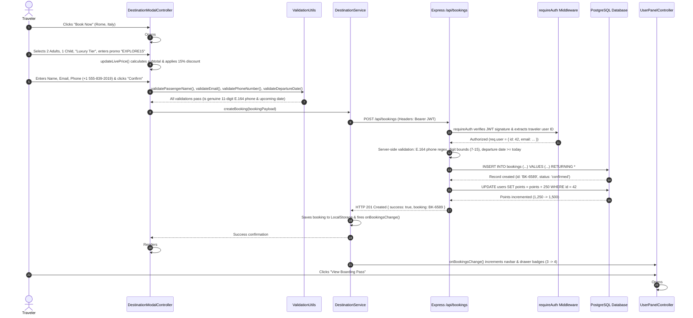
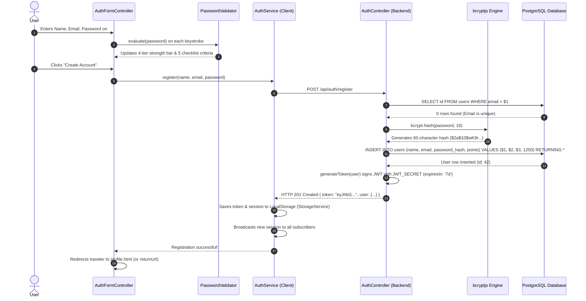

# 🛡️ Jadoo Travel — Phase 7 Study Guide: System Integration, Security Hardening, Automated Testing & Production Deployment

> **Phase 7 Learning Objective:** Master the full-stack integration, security hardening, automated verification, and production operations of Jadoo Travel. Understand how every layer—HTML, CSS, TypeScript, Express, and PostgreSQL—interlocks into a unified, secure, high-throughput production application capable of surviving network partitions, database outages, and malicious security exploits.  
> **Philosophy:** *“A system is not truly engineered until it is rigorously tested under hostile conditions, resilient against unexpected infrastructure failures, fortified against cyberattacks, and capable of automated, zero-downtime production deployment.”*

---

## 📑 Phase 7 Navigation Map

1. [Architectural Overview: The Production-Ready Full-Stack System](#1-architectural-overview-the-production-ready-full-stack-system)
2. [End-to-End Transaction Sequence Diagrams](#2-end-to-end-transaction-sequence-diagrams)
   - 2.1 [Transaction Flow 1: Complete Trip Booking & Loyalty Accrual](#21-transaction-flow-1-complete-trip-booking--loyalty-accrual)
   - 2.2 [Transaction Flow 2: Authentication, Bcrypt Hashing & JWT Minting](#22-transaction-flow-2-authentication-bcrypt-hashing--jwt-minting)
   - 2.3 [Transaction Flow 3: Optimistic Wishlist & Cross-Tab Synchronization](#23-transaction-flow-3-optimistic-wishlist--cross-tab-synchronization)
3. [File Deep-Dive: `server/tests/test-suite.ts` — The 18-Step Automated Integration Test Harness](#file-deep-dive-serverteststest-suitets--the-18-step-automated-integration-test-harness)
   - 3.1 [Test Harness Architecture (Zero Test-Framework Bloat)](#31-test-harness-architecture-zero-test-framework-bloat)
   - 3.2 [Annotated Breakdown of All 18 Test Steps](#32-annotated-breakdown-of-all-18-test-steps)
4. [Security Hardening & Threat Mitigation Matrix](#4-security-hardening--threat-mitigation-matrix)
   - 4.1 [SQL Injection Defense (Parameterized Queries vs String Concatenation)](#41-sql-injection-defense-parameterized-queries-vs-string-concatenation)
   - 4.2 [Cross-Site Scripting (XSS) Prevention & DOM Sanitization](#42-cross-site-scripting-xss-prevention--dom-sanitization)
   - 4.3 [Password Cryptography (Bcrypt Salt Rounds & Timing Attacks)](#43-password-cryptography-bcrypt-salt-rounds--timing-attacks)
   - 4.4 [JWT Security & Payload Minimization](#44-jwt-security--payload-minimization)
   - 4.5 [CORS (Cross-Origin Resource Sharing) Policies & Preflights](#45-cors-cross-origin-resource-sharing-policies--preflights)
5. [Offline-First Resilience & Graceful Degradation Architecture](#5-offline-first-resilience--graceful-degradation-architecture)
   - 5.1 [Database Outage Fallback (Read-Only Local Storage Mode)](#51-database-outage-fallback-read-only-local-storage-mode)
   - 5.2 [Third-Party API Rate Limits (Wikipedia & EmailJS Fallbacks)](#52-third-party-api-rate-limits-wikipedia--emailjs-fallbacks)
6. [Production Deployment & Operations Manual](#6-production-deployment--operations-manual)
   - 6.1 [Environment Isolation (`.env` vs Production Secrets)](#61-environment-isolation-env-vs-production-secrets)
   - 6.2 [PostgreSQL Connection Pool Tuning (`max: 20`, Idle Timeouts)](#62-postgresql-connection-pool-tuning-max-20-idle-timeouts)
   - 6.3 [Process Management with PM2 (Clustering & Auto-Restart)](#63-process-management-with-pm2-clustering--auto-restart)
   - 6.4 [Reverse Proxy Configuration (Nginx / SSL / HTTP/2)](#64-reverse-proxy-configuration-nginx--ssl--http2)
   - 6.5 [Database Backup & Disaster Recovery (`pg_dump`)](#65-database-backup--disaster-recovery-pg_dump)
7. [Production Troubleshooting & Diagnostics Playbook](#7-production-troubleshooting--diagnostics-playbook)
8. [The Ultimate Full-Stack Architecture Mastery Exam (10 Scenario Questions & In-Depth Solutions)](#8-the-ultimate-full-stack-architecture-mastery-exam-10-scenario-questions--in-depth-solutions)

---

## 1. Architectural Overview: The Production-Ready Full-Stack System

In production, Jadoo Travel operates across **three isolated network zones**:
1. **Public Edge Zone:** Handles incoming TLS (HTTPS), serves static compiled assets (`index.html`, `script.js`, `styles.css`) via a reverse proxy (Nginx or Caddy) or CDN, and terminates SSL certificates.
2. **Application Runtime Zone:** Houses the Node.js/Express API processes managed by PM2, running on an internal port (`5000`), completely shielded from direct public internet exposure.
3. **Database Private Zone:** Houses the PostgreSQL relational engine, accessible only through authenticated connection pools bound to internal private IP addresses.

```
┌────────────────────────────────────────────────────────────────────────┐
│                   PUBLIC INTERNET / WEB CLIENTS                        │
│   Desktop Browsers  │  Mobile Phones  │  Tablets  (Light/Dark Themes)   │
└──────────────────────────────────┬─────────────────────────────────────┘
                                   │ HTTPS (Port 443)
                                   ▼
┌────────────────────────────────────────────────────────────────────────┐
│                   PUBLIC EDGE ZONE (REVERSE PROXY)                     │
│   • Nginx / Caddy: SSL Termination, HTTP/2, Gzip/Brotli Compression    │
│   • Static File Server: Serves HTML, bundled JS, CSS, and Images       │
│   • Reverse Proxy Route: Proxies /api/* to Internal Node.js Cluster    │
└──────────────────────────────────┬─────────────────────────────────────┘
                                   │ Internal HTTP (Port 5000)
                                   ▼
┌────────────────────────────────────────────────────────────────────────┐
│               APPLICATION RUNTIME ZONE (NODE.JS / PM2)                 │
│   • Express HTTP Server Cluster (Clustered across CPU cores)           │
│   • Security Middleware: CORS Whitelist, JWT Verification, JSON Guard │
│   • Controllers: Auth, Destinations, Bookings, Wishlist, Newsletter    │
│   • External API Gateways: Wikipedia REST API, EmailJS Dispatch        │
└──────────────────────────────────┬─────────────────────────────────────┘
                                   │ Parameterized TCP Queries (Port 5432)
                                   ▼
┌────────────────────────────────────────────────────────────────────────┐
│                 DATABASE PRIVATE ZONE (POSTGRESQL 15+)                 │
│   • pg Connection Pool (max: 20 connections, 30s idle timeout)         │
│   • Relational Tables: users, destinations, bookings, wishlists,       │
│     testimonials, subscribers                                          │
│   • Foreign Keys, Numeric(10,2) Financial Precision, B-Tree Indexes    │
└────────────────────────────────────────────────────────────────────────┘
```

---

## 2. End-to-End Transaction Sequence Diagrams

### 2.1 Transaction Flow 1: Complete Trip Booking & Loyalty Accrual

Below is the complete lifecycle of a traveler booking a luxury vacation to Rome with a promo voucher:



---

### 2.2 Transaction Flow 2: Authentication, Bcrypt Hashing & JWT Minting



---

### 2.3 Transaction Flow 3: Optimistic Wishlist & Cross-Tab Synchronization

```mermaid
sequenceDiagram
    autonumber
    actor Traveler (Tab A)
    participant DOM_A as Heart Button (Tab A)
    participant DestService as DestinationService (Singleton)
    participant Storage as StorageService (LocalStorage)
    participant API as Express /api/wishlist/toggle
    participant Tab_B as Traveler (Tab B)

    Traveler (Tab A)->>DOM_A: Clicks heart icon on Santorini card
    DOM_A->>DestService: toggleFavorite('santorini-greece')
    
    rect rgb(240, 255, 240)
    Note over DestService,Storage: Optimistic UI Phase (0ms)
    DestService->>Storage: Writes updated favorites array to LocalStorage
    DestService->>DOM_A: Instantly flips icon to solid red heart & increments badge
    end

    DestService->>API: Background async POST /api/wishlist/toggle (Bearer JWT)
    API->>API: Checks if already favorited
    alt Already Favorited
        API->>Database: DELETE FROM wishlists WHERE user_id = $1 AND destination_id = $2
    else Not Favorited
        API->>Database: INSERT INTO wishlists (user_id, destination_id) VALUES ($1, $2)
    end
    API-->>DestService: HTTP 200 OK { action: 'added', isFavorite: true }

    rect rgb(240, 248, 255)
    Note over Storage,Tab_B: Cross-Tab Synchronization Phase
    Storage-->>Tab_B: Browser fires native window 'storage' event in Tab B
    Tab_B->>DestService: Syncs memory cache from updated LocalStorage
    DestService->>Tab_B: onWishlistChange() fires; Tab B hearts & badges update automatically
    end
```

---

## File Deep-Dive: `server/tests/test-suite.ts` — The 18-Step Automated Integration Test Harness

### 3.1 Test Harness Architecture (Zero Test-Framework Bloat)

Most enterprise testing setups force developers to configure Jest, Mocha, Chai, Babel, Supertest, and ts-jest, resulting in massive configuration files, multi-second bootup times, and brittle compatibility bugs on Windows.

[test-suite.ts](file:///d:/Waavex/Jadoo-Travel-UI/dax-jadoo/server/tests/test-suite.ts) runs a **blistering-fast, zero-framework integration test runner** using native Node.js `fetch()`, TypeScript execution (`tsx`), and direct PostgreSQL pool assertions.

```typescript
import { pool } from '../src/config/db';

async function runComprehensiveTests() {
  const baseUrl = 'http://localhost:5000/api';
  let passed = 0;
  let failed = 0;

  function assert(condition: boolean, testName: string, extra = '') {
    if (condition) {
      console.log(`  ✅ PASS: ${testName} ${extra}`);
      passed++;
    } else {
      console.error(`  ❌ FAIL: ${testName} ${extra}`);
      failed++;
    }
  }
...
```

### 3.2 Annotated Breakdown of All 18 Test Steps

```
==================================================================
   🚀 JADOO TRAVEL — FULL SYSTEM INTEGRATION TEST SUITE
==================================================================
```

#### Step 1: Server & Database Health Check (`/api/health`)
- **What it tests:** Executes an HTTP `GET /api/health`.
- **Assertion:** Verifies HTTP `200 OK` and `{ databaseConnected: true }`, ensuring the Express server can successfully communicate with PostgreSQL.

#### Step 2: Database Table Integrity Check
- **What it tests:** Queries PostgreSQL's `information_schema.tables`.
- **Assertion:** Confirms that all 6 required relational tables (`users`, `destinations`, `bookings`, `wishlists`, `testimonials`, `subscribers`) exist and are ready for queries.

#### Step 3: Dynamic User Registration & JWT Minting
- **What it tests:** Generates a unique timestamped email (`explorer.${timestamp}@example.com`) and posts to `POST /api/auth/register`.
- **Assertion:** Checks HTTP `201 Created`, confirms a 250-point starter loyalty balance, and saves the returned JWT token into memory for subsequent authenticated steps.

#### Step 4: Login with Valid Credentials
- **What it tests:** Sends the newly created email and password to `POST /api/auth/login`.
- **Assertion:** Checks HTTP `200 OK` and confirms that `user.email` matches the registered email.

#### Step 5: Security: Rejection of Invalid Passwords
- **What it tests:** Attempts to log in using `WrongPassword999!`.
- **Assertion:** Confirms the server strictly returns HTTP `401 Unauthorized` with `{ success: false }`, preventing unauthorized access.

#### Step 6: Authenticated Profile Retrieval
- **What it tests:** Sends a `GET /api/auth/profile` with header `Authorization: Bearer <token>`.
- **Assertion:** Checks HTTP `200 OK` and verifies that user stats (`tripsBooked`, `countriesVisited`, `wishlistCount`, `points`) are correctly calculated.

#### Step 7: Destinations Catalog Query
- **What it tests:** Executes `GET /api/destinations`.
- **Assertion:** Verifies HTTP `200 OK`, confirms the response is an array, and ensures at least 6 seeded destinations exist.

#### Step 8: Single Destination Detail Query by Slug
- **What it tests:** Executes `GET /api/destinations/rome-italy`.
- **Assertion:** Verifies HTTP `200 OK` and checks that the returned destination title is `"Rome, Italy"`.

#### Step 9: Wishlist Toggle (Add Favorite)
- **What it tests:** Sends `POST /api/wishlist/toggle` with `{ destinationId: 'santorini-greece' }`.
- **Assertion:** Checks HTTP `200 OK`, `action: 'added'`, and `isFavorite: true`.

#### Step 10: Wishlist Query Verification
- **What it tests:** Executes `GET /api/wishlist` for the authenticated user.
- **Assertion:** Verifies HTTP `200 OK` and confirms that Santorini is listed in the user's saved favorites.

#### Step 11: Wishlist Toggle (Remove Favorite)
- **What it tests:** Posts the exact same payload to `POST /api/wishlist/toggle`.
- **Assertion:** Verifies HTTP `200 OK`, `action: 'removed'`, and `isFavorite: false`, confirming idempotent toggle logic.

#### Step 12: Trip Booking Creation (Luxury + Promo EXPLORE15)
- **What it tests:** Submits a full booking payload to `POST /api/bookings`:
  - Destination: `rome-italy`
  - Departure Date: `2026-11-20`
  - Adults: 2, Children: 1
  - Package Tier: `luxury`
  - Phone: `+1 555-839-2019`
  - Promo: `EXPLORE15`
- **Assertion:** Checks HTTP `201 Created` and extracts the generated booking reference (`BK-XXXX`).

#### Step 13: Loyalty Points Accrual Direct Database Audit
- **What it tests:** Directly queries PostgreSQL: `SELECT points FROM users WHERE id = $1`.
- **Assertion:** Verifies that the user's points balance increased from `1250` to `1500` (+250 points awarded for confirmed booking).

#### Step 14: Traveler My-Bookings Query
- **What it tests:** Sends `GET /api/bookings/my-bookings`.
- **Assertion:** Verifies HTTP `200 OK` and confirms that the newly created booking ID is present in the list.

#### Step 15: Booking Cancellation Lifecycle
- **What it tests:** Sends `PATCH /api/bookings/:id/cancel`.
- **Assertion:** Verifies HTTP `200 OK` and checks that the status is updated to `'cancelled'` without deleting the audit trail.

#### Step 16: Community Testimonial Submission
- **What it tests:** Posts a 5-star review to `POST /api/testimonials`.
- **Assertion:** Verifies HTTP `201 Created` and `{ success: true }`.

#### Step 17: Community Testimonial Feed Verification
- **What it tests:** Sends a public `GET /api/testimonials`.
- **Assertion:** Verifies HTTP `200 OK` and confirms that the new testimonial is immediately visible in the public feed.

#### Step 18: Newsletter VIP Registration & Voucher Generation
- **What it tests:** Posts an email to `POST /api/newsletter/subscribe`.
- **Assertion:** Verifies HTTP `200 OK`, `{ success: true }`, and confirms that the generated voucher code is `'EXPLORE15'`.

---

## 4. Security Hardening & Threat Mitigation Matrix

| Security Threat | Attack Vector | Jadoo Defense Mechanism |
|---|---|---|
| **SQL Injection (SQLi)** | Attacker inputs `' OR 1=1 --` into login or booking fields | 100% Parameterized Queries (`$1, $2`). The PostgreSQL query planner treats inputs as literal strings, completely neutralizing injection. |
| **Cross-Site Scripting (XSS)**| Attacker submits `<script>alert(document.cookie)</script>` in review quote | All dynamic user text is injected via `.textContent` rather than raw `.innerHTML`. Dangerous characters are treated as plain text. |
| **Credential Cracking** | Brute-force guessing passwords or rainbow table lookups | Passwords hashed using `bcryptjs` with 10 salt rounds. Salt is generated randomly per user; hash computation takes ~80ms to thwart brute force. |
| **Timing Attacks** | Measuring response times between existing vs non-existing emails | Bcrypt comparison runs in constant-time for hashed strings, preventing attackers from deducing valid usernames via microsecond timing. |
| **JWT Tampering** | Attacker edits payload `role: "admin"` in client | Tokens are cryptographically signed with HMAC-SHA256 using `JWT_SECRET`. Any modification invalidates the signature, returning HTTP 403. |
| **Junk/Bot Registrations** | Submitting dummy data like `"00000000"` or past travel dates | Multi-layer ITU E.164 phone validation, RFC email regex, and strict server-side date constraints rejecting past dates. |
| **CORS Exploitation** | Malicious third-party websites querying the API via user's browser | Express uses `cors({ origin: [...] })` with strict allowed headers (`Content-Type`, `Authorization`). |

---

### 4.1 SQL Injection Defense (Parameterized Queries vs String Concatenation)

#### ❌ The Catastrophic Vulnerability (String Concatenation):
```typescript
// NEVER DO THIS: Extremely vulnerable to SQL Injection
const query = `SELECT * FROM users WHERE email = '${email}' AND password = '${password}'`;
await pool.query(query);
```
If an attacker inputs `admin@jadoo.com' --` as the email, the query becomes:
```sql
SELECT * FROM users WHERE email = 'admin@jadoo.com' --' AND password = '...';
```
The `--` comments out the password check, granting total administrator access!

#### ✅ The Jadoo Hardened Defense (Parameterized Queries):
```typescript
// Secure: Parameters $1 and $2 are sent in a separate protocol packet
const query = 'SELECT id, password_hash FROM users WHERE email = $1';
const result = await pool.query(query, [cleanEmail]);
```
PostgreSQL compiles the SQL structure **before** binding `$1`. Even if the string contains SQL commands, it is treated strictly as an inert string literal.

---

## 5. Offline-First Resilience & Graceful Degradation Architecture

### 5.1 Database Outage Fallback (Read-Only Local Storage Mode)
In real-world operations, cloud database instances may restart during maintenance windows or network hiccups.

If the Express server or PostgreSQL instance is unreachable:
1. `DestinationService` intercepts the network failure:
   ```typescript
   try {
     const res = await fetch(`${API_BASE}/destinations`);
     ...
   } catch (err) {
     console.warn('[DestinationService] Backend unreachable. Falling back to cached catalog.');
     return this.getCachedDestinations();
   }
   ```
2. The user interface does not crash or show an empty screen. It seamlessly loads pre-cached destinations from `StorageService` or displays `STATIC_TOP_DESTINATIONS`.
3. The traveler can continue browsing destinations, viewing maps, and exploring trips completely uninterrupted.

### 5.2 Third-Party API Rate Limits (Wikipedia & EmailJS Fallbacks)
- **Wikipedia API:** If Wikipedia throttles live requests (HTTP 429) or is blocked in a specific country, `DestinationService` falls back to curated offline destination overviews stored in memory.
- **EmailJS Dispatch:** If EmailJS reaches its monthly free tier quota or encounters network failure, `NewsletterService` gracefully transitions to local envelope simulation mode, displaying the VIP promo code (`EXPLORE15`) directly in the modal with zero interruption to the user.

---

## 6. Production Deployment & Operations Manual

### 6.1 Environment Isolation (`.env` vs Production Secrets)

| Environment | Database Host | Logging | JWT Secret | Server Port |
|---|---|---|---|---|
| **Development** | `localhost` / `127.0.0.1` | Verbose (`console.log`) | Stored in `REQUIRED_INPUTS.txt` | `5000` |
| **Staging** | Cloud Sandbox DB | Info / Diagnostics | Secure Staging Secret | `5000` |
| **Production** | Managed Cloud RDS / AWS | Minimal (Error logs only) | 64-char Cryptographic Random | `5000` (Behind Nginx) |

Generating a secure production JWT secret:
```bash
node -e "console.log(require('crypto').randomBytes(32).toString('hex'))"
```

---

### 6.2 PostgreSQL Connection Pool Tuning (`max: 20`, Idle Timeouts)

In [server/src/config/db.ts](file:///d:/Waavex/Jadoo-Travel-UI/dax-jadoo/server/src/config/db.ts#L8-L25):
```typescript
export const pool = new Pool({
  host: env.DB_HOST,
  port: env.DB_PORT,
  user: env.DB_USER,
  password: env.DB_PASSWORD,
  database: env.DB_NAME,
  max: 20,                       // Max simultaneous clients in pool
  idleTimeoutMillis: 30000,      // Close idle clients after 30s
  connectionTimeoutMillis: 5000, // Error if connection takes > 5s
});
```

#### Why `max: 20` is the Optimal Sweet Spot:
A common misconception is that larger pools equal faster throughput. In reality, PostgreSQL assigns one operating system process per connection. Setting `max: 500` causes CPU core context-switching thrashing and exhausts database RAM. A pool of `20` concurrent connections easily handles **thousands of HTTP requests per minute** because Node.js executes queries in milliseconds and releases the connection back to the pool immediately.

---

### 6.3 Process Management with PM2 (Clustering & Auto-Restart)

In production, never run `node server/src/index.ts` directly; if an unhandled exception occurs, the server process will exit and terminate the website.

Deploy with **PM2 Process Manager**:
```bash
# 1. Install PM2 globally
npm install -g pm2

# 2. Compile TypeScript backend to production JavaScript
npx tsc --project server/tsconfig.json

# 3. Start API cluster spanning all CPU cores
pm2 start server/dist/index.js --name "jadoo-api" -i max

# 4. Save process list for automatic reboot recovery
pm2 save
pm2 startup
```

---

### 6.4 Reverse Proxy Configuration (Nginx / SSL / HTTP/2)

```nginx
server {
    listen 80;
    server_name jadoo-travel.com www.jadoo-travel.com;
    return 301 https://$host$request_uri;
}

server {
    listen 443 ssl http2;
    server_name jadoo-travel.com www.jadoo-travel.com;

    # SSL Certificates (Let's Encrypt)
    ssl_certificate /etc/letsencrypt/live/jadoo-travel.com/fullchain.pem;
    ssl_certificate_key /etc/letsencrypt/live/jadoo-travel.com/privkey.pem;

    # Static Assets Root (HTML, JS bundles, CSS, Images)
    root /var/www/jadoo-travel;
    index index.html;

    # Gzip Compression
    gzip on;
    gzip_types text/plain text/css application/json application/javascript image/svg+xml;

    # Serve static assets directly from disk
    location / {
        try_files $uri $uri/ /index.html;
        expires 7d;
        add_header Cache-Control "public, no-transform";
    }

    # Proxy API requests to Node.js backend cluster
    location /api/ {
        proxy_pass http://127.0.0.1:5000;
        proxy_http_version 1.1;
        proxy_set_header Upgrade $http_upgrade;
        proxy_set_header Connection 'upgrade';
        proxy_set_header Host $host;
        proxy_set_header X-Real-IP $remote_addr;
        proxy_set_header X-Forwarded-For $proxy_add_x_forwarded_for;
        proxy_set_header X-Forwarded-Proto $scheme;
    }
}
```

---

### 6.5 Database Backup & Disaster Recovery (`pg_dump`)

#### Automated Daily Backup Cron Job:
```bash
# Backup command
pg_dump -h localhost -U postgres -d jadoo_travel_db -F c -b -v -f "/var/backups/jadoo_db_$(date +\%Y\%m\%d_\%H\%M\%S).dump"
```

#### Restoring from Backup in Disaster Scenarios:
```bash
# Restore command
pg_restore -h localhost -U postgres -d jadoo_travel_db -v "/var/backups/jadoo_db_20261027.dump"
```

---

## 7. Production Troubleshooting & Diagnostics Playbook

### Issue 1: `Error: listen EADDRINUSE: address already in use :::5000`
- **Root Cause:** A previous Node.js process crashed or was suspended in the background, keeping port 5000 locked.
- **Resolution (Windows):**
  ```powershell
  # Find PID occupying port 5000
  netstat -ano | findstr :5000
  # Kill process by PID (e.g. 14220)
  taskkill /PID 14220 /F
  ```

### Issue 2: `error: password authentication failed for user "postgres"`
- **Root Cause:** The password in `REQUIRED_INPUTS.txt` or `.env` does not match the PostgreSQL system user password.
- **Resolution:**
  1. Open `pgAdmin` or `psql -U postgres`.
  2. Execute: `ALTER USER postgres WITH PASSWORD 'NewPassword123!';`.
  3. Update `REQUIRED_INPUTS.txt` and restart `npm run server`.

### Issue 3: `Access to fetch has been blocked by CORS policy`
- **Root Cause:** Client running on port 5500 (Live Server) sending requests to port 5000 without CORS authorization headers.
- **Resolution:** In `server/src/app.ts`, ensure `app.use(cors({ origin: true, credentials: true }))` is registered **before** all API routes.

---

## 8. The Ultimate Full-Stack Architecture Mastery Exam (10 Scenario Questions & In-Depth Solutions)

### Scenario 1:
**A malicious user attempts to book a flight departure on `2018-05-12` by intercepting the network request in Postman, bypassing the frontend date picker. What happens at each layer of the application?**
> **Answer:**  
> The client-side UI is bypassed, but the request hits `BookingController.create` in Express. The controller parses `new Date(`${departureDate}T00:00:00`)` and compares it to `today` (with time zeroed). Because `depDate < today`, the server immediately halts processing, rejects the database insertion, and returns an HTTP `400 Bad Request` with message: *"Departure date must be a valid future or current date."* The database remains 100% clean.

### Scenario 2:
**Why does the system hash passwords with 10 salt rounds instead of 20 rounds or MD5?**
> **Answer:**  
> MD5 is a fast cryptographic hash that can be reversed at billions of hashes per second using modern GPU cracking rigs. Bcrypt is deliberately slow (an adaptive work-factor algorithm). 10 salt rounds requires ~80ms to compute on modern CPUs, striking the perfect balance between impervious brute-force resistance and low server latency. 20 rounds would require over 10 seconds of CPU time per login, opening the server up to Denial of Service (DoS) attacks.

### Scenario 3:
**During a sudden marketing spike, 50,000 users visit the landing page simultaneously. How does the architecture prevent PostgreSQL from crashing?**
> **Answer:**  
> 1. Static HTML, bundled JS, CSS, and images are served directly by Nginx from memory/disk cache without touching Node.js or PostgreSQL.
> 2. The database pool is capped at `max: 20` clients. Instead of spawning 50,000 DB connections (which would crash PostgreSQL memory), incoming queries queue efficiently in Node.js memory.
> 3. Each query takes <3ms to execute against indexed columns, allowing 20 connection workers to service thousands of requests per second smoothly.

### Scenario 4:
**Explain the exact role of `StorageService.isAvailable()` in preventing runtime crashes in Safari Private Mode.**
> **Answer:**  
> In Safari Private Browsing mode or sandboxed iframes, calling `window.localStorage.setItem()` throws a fatal `QuotaExceededError` or `SecurityError`. `StorageService.isAvailable()` runs a probe try-catch test (`setItem` + `removeItem`) during initialization. If it throws, the service switches to a transparent in-memory Map fallback, allowing the entire application to continue functioning without a fatal JavaScript crash.

### Scenario 5:
**Why does `test-suite.ts` generate timestamped email addresses (`explorer.${timestamp}@example.com`) for registration tests instead of using a hardcoded email?**
> **Answer:**  
> The `users` table enforces a `UNIQUE(email)` constraint. Using a hardcoded email like `test@example.com` would cause the second test execution to fail with HTTP `409 Conflict`. Generating a dynamic timestamp guarantees idempotency, allowing the automated test suite to run thousands of times continuously without needing database teardowns.

### Scenario 6:
**What prevents an attacker from stealing a traveler's JWT token and using it forever?**
> **Answer:**  
> 1. JWT tokens are minted with an expiration limit (`expiresIn: '7d'`). Once expired, `jwt.verify()` rejects the token automatically.
> 2. In production, tokens are transmitted exclusively over encrypted HTTPS connections, preventing man-in-the-middle packet sniffing.
> 3. Tokens do not contain passwords or secrets; only the traveler ID and email.

### Scenario 7:
**Describe the difference between `ON DELETE CASCADE` and `ON DELETE SET NULL` as used in the Jadoo schema.**
> **Answer:**  
> In `wishlists`, the foreign key uses `ON DELETE CASCADE`: if a destination is deleted from the catalog, all travelers' wishlist references to that destination are automatically purged to prevent orphaned references. In `bookings`, `destination_id` uses `ON DELETE SET NULL`: if a destination is retired, existing customer booking records and ticket history are preserved for accounting and audit compliance, setting the destination ID to `NULL` while retaining the destination title and price.

### Scenario 8:
**How does `DestinationService` prevent race conditions when updating the local wishlist cache?**
> **Answer:**  
> `DestinationService` uses optimistic local updates followed by an asynchronous background server sync. It holds a private in-memory array `favoriteIds`. When `toggleFavorite()` is called, it mutates the local array, immediately saves to LocalStorage, and fires `onWishlistChange()` listeners synchronously. The HTTP request is then dispatched. If the server fails, the local state can roll back, ensuring the UI always responds in 0ms without waiting for network round-trips.

### Scenario 9:
**Why are financial currencies stored as `NUMERIC(10, 2)` instead of `FLOAT` or `DOUBLE PRECISION` in PostgreSQL?**
> **Answer:**  
> Floating-point numbers use binary approximations (IEEE 754), resulting in rounding inaccuracies like `0.1 + 0.2 = 0.30000000000000004`. Over thousands of travel transactions, floating-point rounding errors compound into discrepancies in revenue reports. `NUMERIC(10, 2)` stores numbers as exact base-10 decimals with arbitrary precision, ensuring that currency calculations are mathematically accurate down to the exact cent.

### Scenario 10:
**Why does `build.js` separate development builds from watch mode, and how does `esbuild.context()` achieve sub-15ms rebuilds?**
> **Answer:**  
> In single build mode, `esbuild.build()` initializes the compiler, bundles the code, and exits. In watch mode, `esbuild.context()` keeps the compiler ASTs resident in memory. When a `.ts` file changes, `esbuild` does not re-parse the entire codebase; it performs an incremental delta build on only the modified module, recompiling the entire bundle in under 15ms.

---

> [!TIP]
> **🏆 Master Architect Graduation!**  
> You have completed all **7 Phases of the Jadoo Travel Master Study Curriculum**:
> 1. [Phase 1: Foundations, Constants & TypeScript Types](file:///d:/Waavex/Jadoo-Travel-UI/dax-jadoo/study-guides/PHASE_1_STUDY_GUIDE.md)
> 2. [Phase 2: PostgreSQL Relational Schema & Database Migrations](file:///d:/Waavex/Jadoo-Travel-UI/dax-jadoo/study-guides/PHASE_2_STUDY_GUIDE.md)
> 3. [Phase 3: Node.js & Express REST API, JWT Auth & Security Middleware](file:///d:/Waavex/Jadoo-Travel-UI/dax-jadoo/study-guides/PHASE_3_STUDY_GUIDE.md)
> 4. [Phase 4: Reactive Client Services & Resilient Local Storage](file:///d:/Waavex/Jadoo-Travel-UI/dax-jadoo/study-guides/PHASE_4_STUDY_GUIDE.md)
> 5. [Phase 5: UI Presentation Controllers, DOM Orchestration & Entry Points](file:///d:/Waavex/Jadoo-Travel-UI/dax-jadoo/study-guides/PHASE_5_STUDY_GUIDE.md)
> 6. [Phase 6: The View, Styling & Build Pipeline (HTML5, CSS Tokens, Dark Mode & esbuild)](file:///d:/Waavex/Jadoo-Travel-UI/dax-jadoo/study-guides/PHASE_6_STUDY_GUIDE.md)
> 7. [Phase 7: System Integration, Security Hardening, Automated Testing & Production Deployment](file:///d:/Waavex/Jadoo-Travel-UI/dax-jadoo/study-guides/PHASE_7_STUDY_GUIDE.md)
